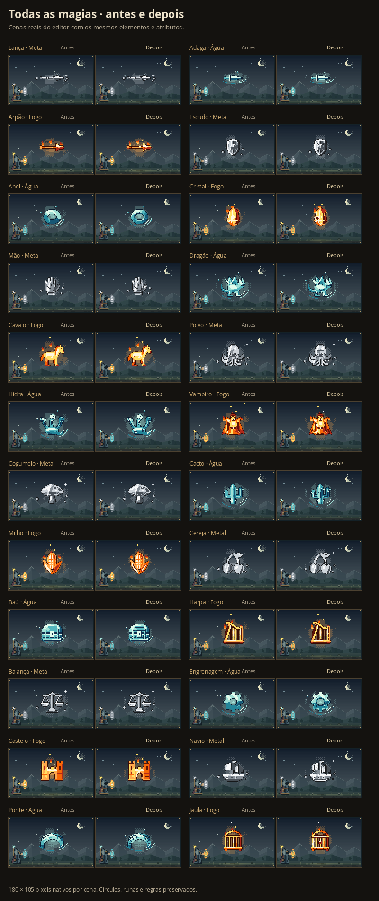
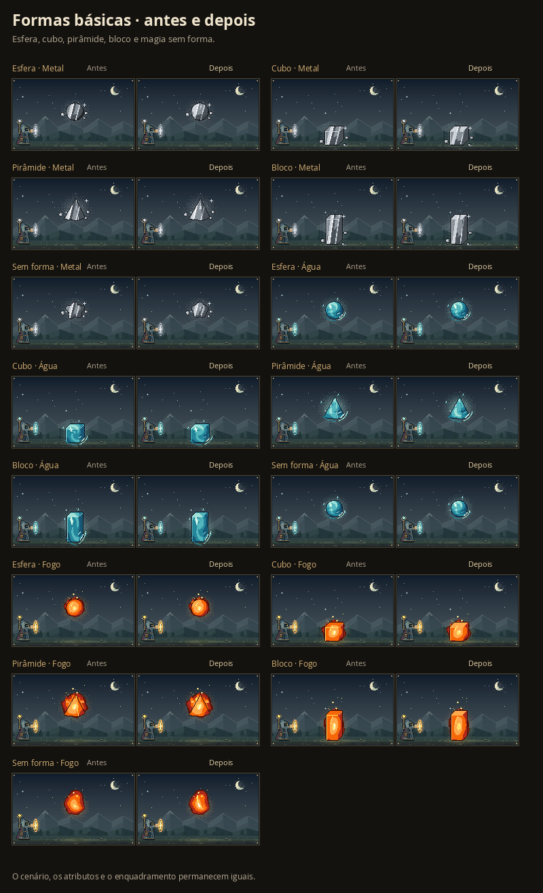

# Todos os sprites de magia refinados

Cada uma das **200 formas de Intenção** recebeu detalhes próprios de desenho. Armas têm encaixes e lâminas esculpidas; objetos e construções mostram juntas, molduras e relevos; plantas ganham nervuras e frutos com volume; criaturas têm rostos, articulações, penas e membros mais definidos. As cores continuam vindo do material escolhido pelas runas.

O acabamento também alcança os corpos básicos: esfera, cubo, paralelepípedo, pirâmide, massa sem forma e chama. Reflexos acompanham o volume e as faces deixam de receber a mesma luz. As chamas têm línguas internas conectadas e bolsões mais escuros. Palavras fora do catálogo mantêm o alfabeto completo de 5 × 7 pixels e recebem luz nas bordas dos traços.

## Comparação com a versão publicada

A referência é o merge `e493ffe`. As imagens vêm do renderizador real, com as mesmas entradas, materiais e sementes, ampliadas sem suavização. A cena permanece em **180 × 105 pixels**.

[Prancha das 200 formas refinadas](visuals/all-sprites-200.png).

## Cobertura

| Tabelas | Formas refinadas |
| --- | ---: |
| Clássicas, armas, equipamentos e arsenal | 41 |
| Objetos, símbolos e ferramentas | 38 |
| Natureza, botânica e artefatos | 37 |
| Animais e criaturas da fauna | 36 |
| Criaturas míticas, lendas, construções e edifícios | 48 |
| **Total de IDs distintos** | **200** |

Os centros de anéis, elos, alças, portais, redes e teias continuam transparentes. Geometria e pintura compartilham os mesmos limites. O refinamento usa polígonos e cores da paleta da magia, sem imagens externas, suavização ou alteração do desenho das runas e círculos.

## Validação

O catálogo mantém os mesmos 200 IDs e 1.103 termos. A interpretação das runas, elementos, atributos, custos, destinos, quantidade, Projétil, Área, Órbita, Ser e persistência permanecem iguais. Os desenhos e as exportações dos círculos mantêm o comportamento existente.

- **2.219 testes em 34 arquivos**, TypeScript e build Vite aprovados.
- Revisão independente das 17 tabelas: 200 IDs e geometrias alteradas, sem duplicações ou ausências; 5.576 partes e 28.538 pontos válidos. 199 formas conservam os limites autorais; a espiral cresce 0,6 por dimensão, com os limites de pintura e layout compartilhados.
- 1.200 sprites diretos em Fogo/Água/Metal, nas escalas 15 e 7,5, e 200 miniaturas do catálogo conferidos, sem cortes.
- 601 casos e 1.202 cenas nativas comparados com a versão publicada. Seis exportações dos círculos, SVG e PNG, continuam idênticas byte a byte.
- Os dados de aparência, atributos e projetos dos 601 casos e dos 45 presets permanecem idênticos à referência; os 200 sprites ilustrados apresentam mudança real de pixels em ambos os tamanhos e nos três materiais conferidos.
- As 96 cenas básicas e os 96 casos tipográficos mudam visualmente. As máscaras das letras e seus limites continuam iguais, inclusive em palavras de 40 caracteres e na direção de retorno.
- Revisão independente dos corpos básicos e glifos: cores válidas e pertencentes à paleta, materiais distintos e variantes escuras preservadas, sem ciclo entre os módulos compilados.
- Stress de 3.200 layouts e 6.400 corpos, mais 150 cenas escuras: nenhum corte ou mutação das entradas, incluindo destinos, Projétil, quantidades e órbitas.
- 20 verificações de interface e 36 capturas: 200 miniaturas, categorias, busca e sugestões, confirmação, bloqueio, quantidade, Ser e salvar/reabrir com pixels iguais. Desktop e celulares de 320/390 px, nos temas claro e escuro, sem transbordamento ou exceções JavaScript.
- Versão compilada validada em 1440 e 320 px sob `/c-rculo-magico/`, do acesso como convidado à vinculação e prévia ampliada; PNG igual à matriz e arquivos locais HTTP 200 com bytes iguais ao build. Google Fonts e a consulta externa de regras estavam indisponíveis no ambiente e usaram o fallback existente; autenticação remota não foi validada neste smoke.
