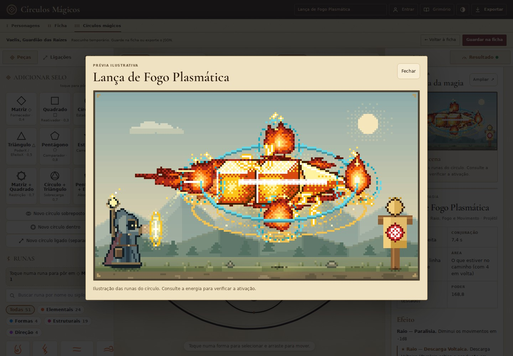
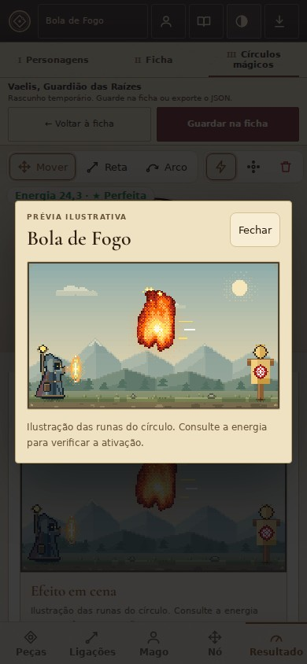

# Prévia da magia

A cena agora usa céu suave, montanhas em camadas, névoa, árvores distantes e chão em tons de musgo e terra. O mago ganhou capa vinho, detalhes de latão e cajado de madeira. A paleta do cenário dá mais destaque aos efeitos, sem alterar os formatos, materiais, posições, órbitas e projéteis descritos pelas runas.

O texto de orientação saiu de cima da arte. O estado vazio explica como formar uma manifestação; quando há efeito, a legenda lembra que a ativação depende da Energia. O nome completo e os vínculos ficam em texto legível, com quebra de linha. A ficha organiza os valores em uma tabela e permite recolher os componentes.

**Ampliar** abre a mesma cena em uma janela maior. O fechamento funciona pelo botão, por Esc e pelo fundo; o foco volta ao botão de abertura. Sair do editor ou ocultar a aplicação fecha a janela. Os atalhos de desfazer/refazer não alcançam o editor atrás dela.

## Validação

- 392 testes passaram, incluindo 10 novos testes de interface da prévia: estado vazio, valores reais, nomes e vínculos com HTML, cache, componentes abertos, ampliação, troca de contexto e atalhos.
- TypeScript e build de produção aprovados.
- Chromium real em 1440 × 1000, 390 × 844 e 320 × 844: estados vazio e ativo, temas claro/escuro, fogo, lança-chamas, lança plasmática e intenção. Nomes e vínculos longos, inclusive 80 caracteres sem espaços, sem corte horizontal após o ajuste de quebra de linha. Abrir e fechar mantêm alvos de toque de 44 px no celular.
- Exportações SVG e downloads PNG idênticos byte a byte à referência `470dc60`, para Bola de Fogo, Lança-Chamas e Lança Plasmática nos temas claro e escuro: 12 arquivos comparados.
- A cena só é rasterizada novamente quando a aparência muda; renomear ou mover sem mudar a manifestação reutiliza as imagens dos dois temas.
- A prévia atrasada só é aplicada se a análise ainda pertence ao mesmo modelo e contexto de edição.

As capturas usam personagens e círculos de demonstração. O desenho e as regras das runas e dos círculos permanecem preservados.
