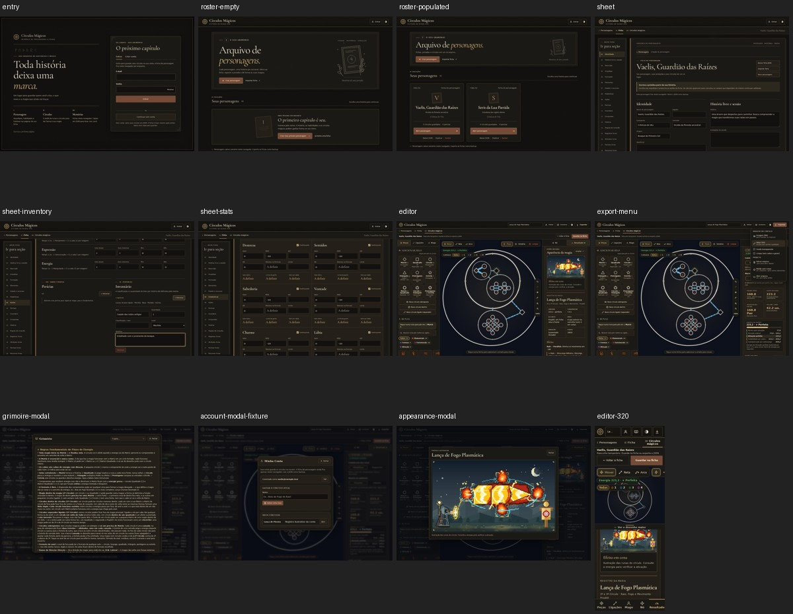

# Grimório integralmente escuro

O tema Grimório agora usa a mesma paleta de couro escuro, tinta clara e dourado discreto na entrada, seleção de personagens, ficha, editor e janelas. A mudança é de acabamento: não altera a estrutura dos círculos, desenhos das runas, cálculos ou dados salvos.

## Comportamento

- Novas visitas, valores de tema desconhecidos e armazenamento indisponível abrem no Grimório.
- O pequeno script síncrono `theme-init.js` aplica a preferência antes do conteúdo. O build usa caminho relativo, compatível com GitHub Pages em `/c-rculo-magico/`.
- Preferências explícitas por Pergaminho ou Caderno permanecem válidas. O nome legado `caderno` continua restaurando Pergaminho.
- O botão de tema mantém a alternância e informa o tema atual e o próximo também no nome acessível.
- `color-scheme` acompanha a escolha, incluindo campos, seletores e controles nativos.
- As cores da interface são locais aos painéis. As variáveis usadas pelos atributos das runas e dos círculos exportados permanecem intactas.

## Validação

- 754 testes aprovados, incluindo nove de inicialização, preferência, armazenamento bloqueado e alternância.
- TypeScript e build Vite aprovados; `theme-init.js` copiado para a saída e referenciado como `./theme-init.js`.
- Revisão independente sem bloqueios de inicialização, isolamento dos temas claros ou preservação da arte.
- 31 capturas por versão, cobrindo entrada, registro, personagens vazios e preenchidos, ficha, índice, inventário, estatísticas, editor, menu de exportação, Grimório, conta e prévia ampliada.
- Conferência em desktop e mobile de 320/390 pixels sem transbordamento horizontal ou erros de página.
- Build de produção conferida com o bundle principal bloqueado: o script inicial já restaura a preferência e o esquema de cores correto. Entradas vazias, desconhecidas e armazenamento bloqueado abrem no Grimório.
- Amostra de textos e rótulos de controles nas telas verificadas com contraste mínimo de 5,68:1; foco dourado visível de dois pixels.
- Três SVGs e três PNGs dos exemplos `ex1`, `ex2` e `m_lanca_plasmatica` idênticos, byte a byte, ao tema Grimório anterior no commit `d3ff7a9e`.

A conta foi inspecionada com dados de demonstração locais. A conferência visual não enviou credenciais nem alterou contas reais.
