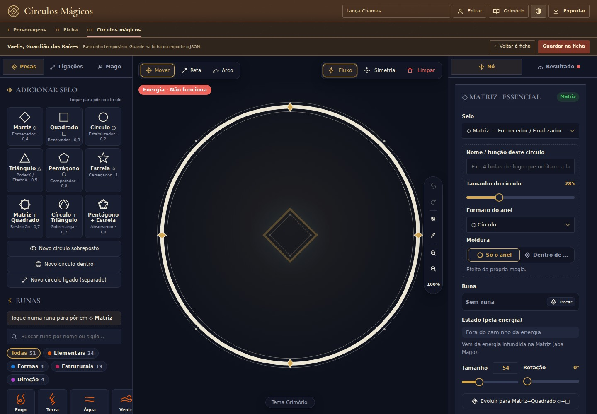
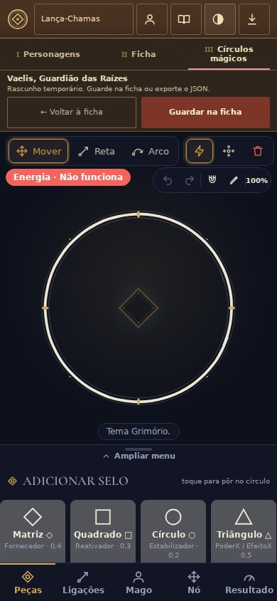

# Mais espaço no editor

O cabeçalho, as abas e a faixa do personagem ocupavam três linhas altas. A compactação reduz margens, títulos e alturas mínimas somente durante a criação de círculos. O nome duplicado nas abas foi removido; voltar, guardar, exportar, exemplos, conta e Grimório permanecem disponíveis. O aviso de rascunho continua visível e é mais curto.

## Comparação no navegador

Referência anterior: `f4b9b62`. Mesmo personagem de demonstração e mesmo círculo, em Chromium com renderização por software.

| Tela | Altura das três faixas antes | Depois | Espaço recuperado |
|---|---:|---:|---:|
| Desktop 1440 × 1000 | 194 px | 135 px | 59 px |
| Desktop 1920 × 1080 | 194 px | 135 px | 59 px |
| Celular 390 e 320 × 844 | 229,59 px | 185,39 px | 44,20 px |
| Paisagem 844 × 390, toque | 190 px | 157 px | 33 px |

No desktop de 1440 × 1000, a área de trabalho passou de 806 para 865 px de altura. Nomes e mensagens longas continuam podendo quebrar linhas.

## Verificações

- 17 testes da interface de personagens e build de produção passaram localmente. Os testes confirmam a troca do estado visual entre seleção, ficha e editor; a suíte completa roda no CI.
- Controles do topo com pelo menos 44 × 44 px em celular e ponteiro de toque; foco de teclado visível. Menus de exportação, Grimório e acesso à conta continuam acessíveis.
- Nome de 160 caracteres e mensagem de 450 caracteres sem recortes; nenhuma rolagem horizontal ou erro de JavaScript observado.
- Voltar à ficha/seleção restaura o cabeçalho de 78 px e a visibilidade original das abas. A seleção continua sem abas.
- Com o mesmo desenho, SVGs exportados e imagens PNG de 800 × 800 px são idênticos byte a byte nos temas claro e escuro. Os estilos compactos não alcançam o SVG, o canvas ou os tokens das runas.
