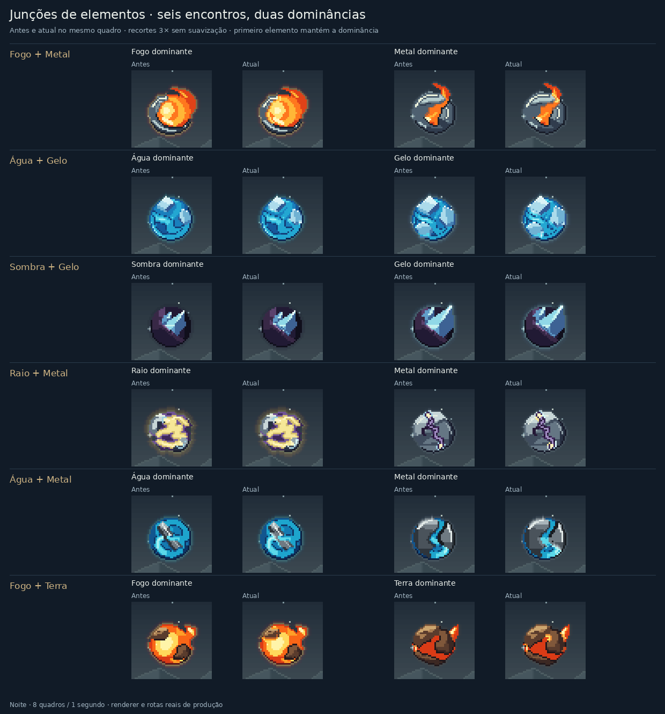

# Junções entre elementos

Esta etapa continua a revisão das quatro esferas puras do commit `0c1bf32c6cec80105b61cfb18983e636891823bf`. O encontro entre materiais ganha movimento e iluminação próprios, mantendo os desenhos de cada corpo e a dominância do primeiro elemento.

Este registro descreve a etapa concluída em `71c881c2`. A revisão seguinte tem desenhos próprios e novas comparações em [Quatro novas composições de elementos](woven-junctions-review.md).

| Encontro | Mudança visual |
| --- | --- |
| Fogo + Metal | O calor percorre o contato real, ilumina a raiz da chama e deixa um bisel de cobre que esfria depois. |
| Fogo + Terra | A frente quente segue as fissuras e alcança a face encostada da rocha. O restante do bloco conserva sua sombra. |
| Água + Gelo | O menisco e a refração percorrem os cortes submersos; as placas mantêm seus planos rígidos. |
| Água + Metal | A corrente projeta um reflexo móvel nos primeiros pixels da borda molhada, preservando os biséis polidos. |
| Raio + Metal | Duas frentes refletidas avançam dos contatos para o centro da junta, com uma curta trilha de resfriamento. |
| Sombra + Gelo | Uma faixa refratada acompanha a raiz do cristal. A fissura escura tem uma parede azul e uma ponta afunilada. |

As seis construções funcionam nas duas ordens dos elementos. As demais misturas físicas usam um relógio espacial compartilhado nas duas faces do contato, com brilhos curtos, bordas de oclusão e reflexos locais. As regiões continuam separadas: um material não pinta por cima do outro nem passa a ocupar uma área diferente a cada quadro. Formas vazadas e alongadas também corrigem a orientação transversal dos materiais no retorno.

Os efeitos usam a resolução nativa e o ciclo existente de oito quadros. Os detalhes mais finos cedem espaço à leitura do corpo nas escalas pequenas. Não foram alterados o editor, as runas, os círculos ou as regras de fusão; coexistência de elementos não acrescenta uma fusão às regras.

## Comparação



[Animação dos seis pares](visuals/element-junctions/authored-night.gif) · [Contatos gerais](visuals/element-junctions/general-night.gif) · [Cópias, órbitas e intenções](visuals/element-junctions/contexts-night.gif) · [Comparação durante o dia](visuals/element-junctions/authored-day.gif)

A base foi congelada antes das alterações, com SHA256 `315b5e45f630854353d09674e2fbc46294b948f0e6c906ab04aaf84022dd21e6`. A prova compila o renderer real, sem substituir fontes ou rotas, e registra os hashes no [manifesto](visuals/element-junctions/manifest.json).

- 896 capturas: 12 dominâncias autorais, quatro pares gerais e 12 contextos, nos dois temas e nos oito quadros.
- 352 comparações idênticas em 22 controles, incluindo os 16 elementos puros e o lança-chamas existente.
- 2.144 verificações de limites e 1.600 verificações de ciclo, de borda e de preservação dos dados de entrada.
- GIFs de oito quadros e um segundo, com paleta global por animação. Os PNGs preservam as cores exatas do renderer.

Os testes de contato verificam que o calor e os reflexos permanecem próximos da superfície vizinha, que as frentes percorrem posições diferentes e que faces rígidas não piscam por inteiro. Os testes gerais também verificam máscaras, cortes, picos de luz, regiões de cada material e retorno de um contato rígido/elétrico.

A suíte completa passou com 3.015 testes em 78 arquivos. TypeScript, build de produção e auditoria sem vulnerabilidades também passaram.

## Reprodução

Em um checkout de `0c1bf32c6cec80105b61cfb18983e636891823bf`, após `npm ci`, congele a base:

```sh
node --input-type=module <<'JS'
import { build } from 'esbuild';
await build({
  stdin: {
    contents: `export {renderPixelScene,PW,PH} from './src/ui/pixel-scene';
      export {appearanceForScene,layoutScene,boundsOfBeing} from './src/ui/pixel-scene-layout';
      export {spellSpriteOf,paintSpellSprite,spellSpriteBounds} from './src/ui/pixel-spell-sprites';
      export {pairSpriteOf} from './src/ui/pixel-pair-sprites';
      export {paintAllocatedMixture} from './src/ui/pixel-mixture-compositor';
      export {Pix} from './src/ui/pixel';`,
    resolveDir: process.cwd(), loader: 'ts'
  },
  bundle: true, platform: 'node', format: 'esm', outfile: '/tmp/junction-baseline.mjs'
});
JS
```

Na versão desta etapa (`71c881c2`):

```sh
npm ci
npm run typecheck
npm test -- --maxWorkers=2
npm run build
npm audit --audit-level=low
node scripts/proof-element-junctions.mjs --baseline /tmp/junction-baseline.mjs
```

O compositor requer Python com Pillow. Os rasters temporários são removidos ao terminar. A inspeção usa as cenas reais do renderer; esta etapa não inclui uma nova sessão interativa no navegador ou medição de desempenho em celular.
