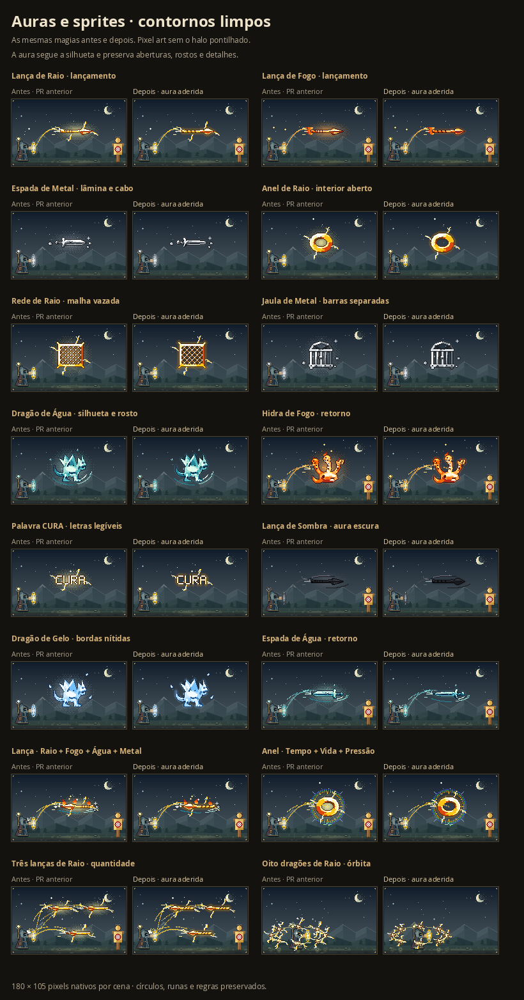
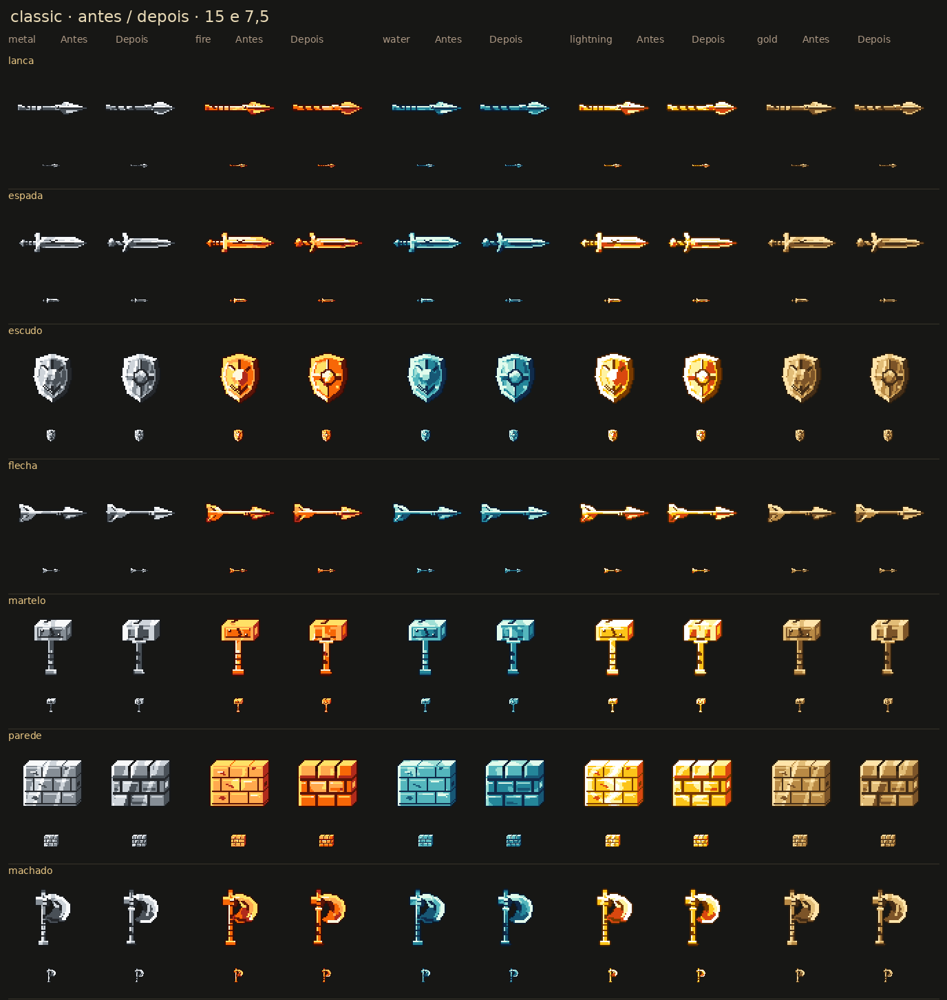

# Aura que acompanha o desenho da Intenção

A lança recebia um grande oval pontilhado calculado pela caixa da magia. O novo brilho acompanha o contorno real do sprite em faixas curtas e contínuas. O fundo permanece visível nos vãos de anéis, redes, grades e letras.

As comparações usam a versão anterior do PR (`fdf35d8`) e as mesmas entradas, materiais, sementes e enquadramento. Cada cena tem 180 × 105 pixels, ampliados sem suavização.

## Desenho e composição

O corpo da Intenção é pintado em uma camada transparente. Sua máscara delimita a luz; uma busca pelo exterior protege espaços fechados e frestas estreitas. Faixas de 2 pixels para Pedra/Metal, 3 para Fogo/Água/Gelo/Vento/Energia e 4 para Plasma substituem o oval. Sombra, Morte e Vazio usam somente tons escuros, com alcance de 2 pixels.

Os efeitos decorativos dos elementos ficam fora do corpo e dos vãos protegidos. Depois deles, a camada do sprite é copiada integralmente, mantendo gumes, rostos, olhos e contornos. O núcleo de um segundo elemento e as indicações de Estado, direção e restrição continuam seguindo as regras existentes. Conceitos incorpóreos permanecem sem corpo sólido.

Em cópias pequenas, com caixa inferior a 20 pixels, a decoração fica até 3 pixels além da caixa do corpo. Isso encurta os raios decorativos que se acumulavam nos vizinhos em órbitas cheias. O corpo, a aura, os trajetos de lançamento e retorno e as indicações estruturais continuam completos.

Lança, espada, escudo, flecha, martelo, parede e machado receberam um novo acabamento, com as mesmas caixas de desenho. A lança ganhou lâmina em folha, nervura, encaixe e haste distintos. Os demais têm componentes e planos mais legíveis em tamanho pequeno, com menos gravuras que se confundiam no raster.

[Miniaturas atuais das 200 formas](visuals/all-sprites-200.png).

## Compatibilidade e validação

O catálogo mantém os 200 IDs e 1.103 palavras. Regras, elementos, custos, quantidade, Ser, Projétil, destinos, órbitas, persistência e resolução das palavras continuam iguais. Os desenhos e as exportações das runas e círculos são preservados.

- **2.245 testes em 35 arquivos**, TypeScript e build Vite aprovados.
- 26 testes específicos de aura verificam faixas contínuas, alcance, cores, sombras, determinismo, bordas, máscaras vazias e preservação de corpo, vãos e frestas.
- Sete geometrias clássicas comparadas nas escalas 15 e 7,5, com Metal, Fogo, Água, Raio e dourado; todos os limites autorais permanecem idênticos.
- Revisão independente da composição, máscaras, segundo elemento, conceitos incorpóreos, retorno, PRNG, limites de memória e imports aprovada. O módulo de aura fica com a lógica do renderizador, separado das tabelas de geometria.
- 1.200 cenas das 200 formas em Fogo/Água/Metal e dia/noite, mais 328 cenas focais, conferidas. Os dados de 601 casos, 164 casos focais e 45 presets permanecem iguais. Só os sete clássicos mudam a geometria e suas miniaturas.
- 3.200 máscaras verificadas: 2.030.560 pixels de corpo e 44.472 pixels de aberturas preservados; 1.035.050 pixels de aura restritos ao contorno. Nenhum erro ou mutação.
- 96 cenas básicas, 96 glifos diretos e seis exportações de círculos continuam idênticos byte a byte. Das 90 imagens dos presets, mudam somente quatro com Intenção: `m_falsa_acao` e `m_supressao`, em dia e noite.
- Stress de 3.200 layouts, 6.400 corpos e 150 cenas escuras: nenhum corte ou mutação, incluindo seis destinos, Projétil, retorno, quantidades e órbitas.
- 20 verificações de interface e 36 capturas, além da lança de Raio em desktop e celulares de 390/320 px: sem transbordamento ou exceções JavaScript. Salvar/reabrir preserva os pixels.
- Versão compilada conferida em 1440 e 320 px sob `/c-rculo-magico/`, com 200 miniaturas e prévia igual à matriz; arquivos locais HTTP 200 e bytes iguais ao build. Google Fonts e regras externas estavam indisponíveis no ambiente e usaram o fallback existente; autenticação remota não foi validada neste smoke.
