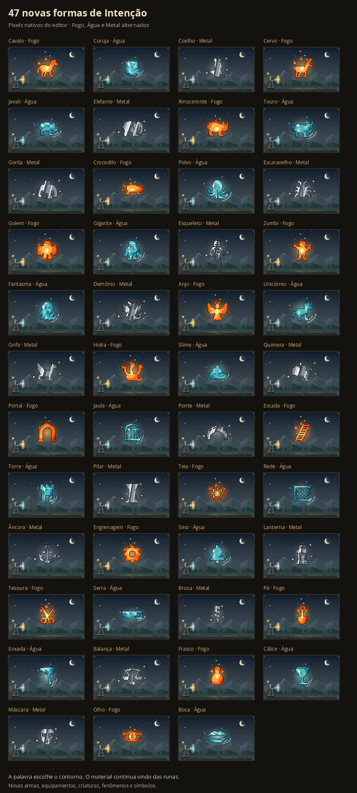
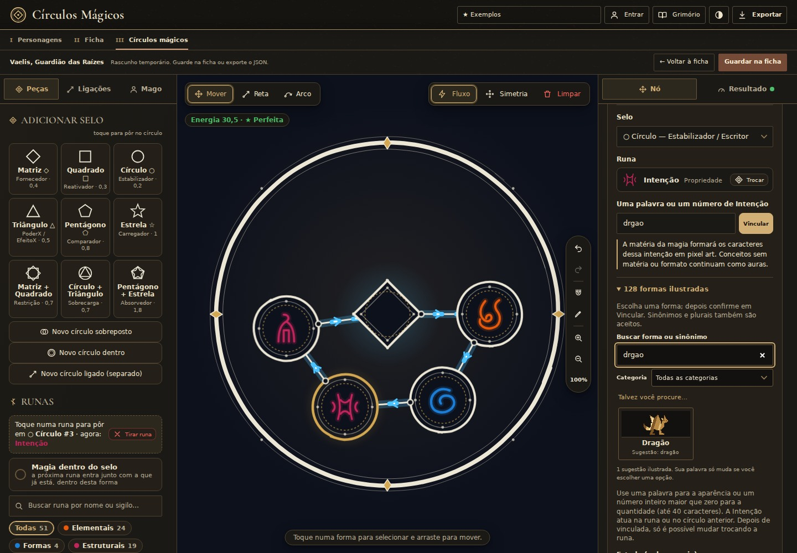

# Mais palavras com formas próprias

O vínculo «bomba» antes desenhava os caracteres da palavra. Agora gera uma bomba em pixel art, com corpo, pavio e faísca feitos do material da magia. O catálogo passou de sete para **128 silhuetas**, reconhecidas por **727 palavras distintas após normalizar acentos e caixa**, incluindo plurais e sinônimos explícitos.

[36 formas de armas, equipamentos e símbolos](visuals/intention-forms-next.png) · [45 outras formas](visuals/intention-forms-expanded.png).

## Formas

| Grupo | Silhuetas |
| --- | --- |
| Armas | Lança, espada, escudo, flecha, martelo, machado, adaga, foice, arco, tridente, chicote, corrente, cajado, picareta, kunai, agulha, shuriken, mangual, clava, besta, bumerangue e disco |
| Objetos e geometria | Parede, bomba, esfera, cubo, pirâmide, cone, anel, estrela, espiral, cruz, coração, coroa, chave, cristal, mão, explosão, ampulheta e crânio |
| Equipamentos | Armadura, elmo, manopla, bota, livro, pergaminho, âncora, engrenagem, sino, lanterna, tesoura, serra, broca, pá, enxada, balança, frasco, cálice e máscara |
| Fenômenos e símbolos | Raio, chama, gota, onda, tornado, nuvem, sol, lua, meteoro e cometa |
| Natureza e criaturas | Árvore, flor, folha, raiz, vinha, asa, garra, presa, serpente, dragão, lobo, pássaro, tentáculo, fênix, urso, leão, raposa, gato, morcego, aranha, escorpião, tartaruga, peixe, tubarão, cogumelo, cavalo, coruja, coelho, cervo, javali, elefante, rinoceronte, touro, gorila, crocodilo, polvo, escaravelho, olho e boca |
| Criaturas míticas | Golem, gigante, esqueleto, zumbi, fantasma, demônio, anjo, unicórnio, grifo, hidra, slime e quimera |
| Construções | Portal, jaula, ponte, escada, torre, pilar, teia e rede |

Sinônimos usam silhuetas genéricas da mesma família: «granada» usa Bomba; «sabre» usa Espada; «cipó» usa Vinha. Plurais também escolhem a mesma forma, sem multiplicar a magia. Uma segunda Intenção numérica continua indicando quantidade.

## Uso no editor

No campo de Intenção, a seção recolhida **128 formas ilustradas** mostra miniaturas reais das silhuetas, permite filtrar por categoria e pesquisar nome ou sinônimo. A busca informa o sinônimo encontrado, e a escolha fica marcada no catálogo. Escolher uma opção apenas preenche o campo e atualiza a leitura; **Vincular** mantém a confirmação existente. Depois de confirmar, o catálogo continua consultável, com as opções bloqueadas até trocar a runa.

A busca aceita «granadas», «DRAGOES» ou «cristais». Se não houver resultado direto, pequenos erros como «drgao», «espdaa» e «relampgo» mostram até quatro sugestões com o aviso **Talvez você procure…**. As sugestões respeitam a categoria e só preenchem o campo após o clique; o texto digitado, o reconhecimento exato da magia e a confirmação do vínculo permanecem preservados. Consultas numéricas, frases, consultas curtas ou longas e símbolos não recebem aproximação. A distância permite uma edição para quatro a sete letras ou duas para oito a quarenta, incluindo transposições vizinhas. As miniaturas douradas mostram a silhueta; a prévia completa continua usando o material e as cores reais da magia. Elas só são desenhadas ao abrir a seção, e os pixels ficam em cache. A vinculação continua limitada a uma palavra ou inteiro positivo por runa, sem aproximar substrings ou aceitar frases. Palavras fora do catálogo preservam o desenho tipográfico existente.

## Arte e regras

Todas as novas formas são polígonos rasterizados pelo mesmo painter e recebem `materialPixel`: nenhuma lâmina, cabo, planta ou criatura força madeira, metal ou outra matéria. Elementos, estados, origem, direção, Projétil, Área, Órbita e Ser permanecem determinados pelas runas. Uma bomba não ganha dano explosivo automaticamente, uma asa não cria voo e um dragão não cria vida. «Raio» ou «chama» apenas escolhem uma silhueta: uma chama feita de Água continua Água, sem ganhar propriedades de Fogo. Armaduras e livros também são apenas a forma da matéria, sem novos bônus ou efeitos. Criaturas míticas não ganham vida nem ações automaticamente; um Portal é uma silhueta arqueada, sem acrescentar teletransporte.

Os 81 desenhos que já tinham silhuetas permanecem intactos. O catálogo define artigos em português para a descrição, como «uma bomba», «um dragão» e «um cristal». Nenhuma migração de projeto, alteração de energia ou nova regra de custo foi introduzida.

## Validação

Testes cobrem as 128 formas, todos os aliases, consulta exata, gêneros, persistência, escolha sem vínculo automático, catálogo bloqueado, pixels e limites de desenho. O layout verifica cada forma nos seis destinos, com e sem Projétil, quantidades, oito órbitas e preservação das entradas. A conferência visual inclui Fogo, Água e Metal e o caso de bomba multimatéria em Área mostrado na imagem enviada.

- **1.674 testes aprovados**, em 33 arquivos, com TypeScript e build Vite aprovados.
- 128 formas × três materiais × dia/noite: 768 cenas nativas conferidas.
- As 486 imagens de referência das 81 formas anteriores são idênticas, byte a byte, às anteriores.
- Os 45 presets mantêm a mesma interpretação, propriedades e estatísticas; três SVGs e três PNGs dos círculos também permanecem idênticos.
- Revisão independente do catálogo, artigos, consulta exata, segurança e seleção sem vínculo automático: sem bloqueios.
- Fluxos de «ÉGUAS», «octópodes», «mortos-vivos», «hipogrifos», «portais», «grades», «lampiões», «poções» e «mandíbulas» aprovados, com elementos e estatísticas preservados. Uma Intenção «slime» e outra «3» mostram três slimes; salvar/reabrir preserva os pixels, e o escopo por Ser permanece correto. As validações anteriores também cobriram bomba/dragão/fênix, troca de runa e histórico.
- 17 verificações de UI e 36 capturas conferidas em desktop e celulares de 320/390 pixels, nos temas Grimório e Pergaminho, sem erros de página ou transbordamento. Miniaturas, busca combinada com categoria, sinônimos, sugestões explícitas, seleção, bloqueio e modal com Esc aprovados. «drgao», «espdaa» e «relampgo» exigem escolha e confirmação; vincular «drgao» diretamente ainda preserva a palavra livre. Catálogo aberto mede 270/270 e 340/340 pixels de largura disponível/ocupada.
