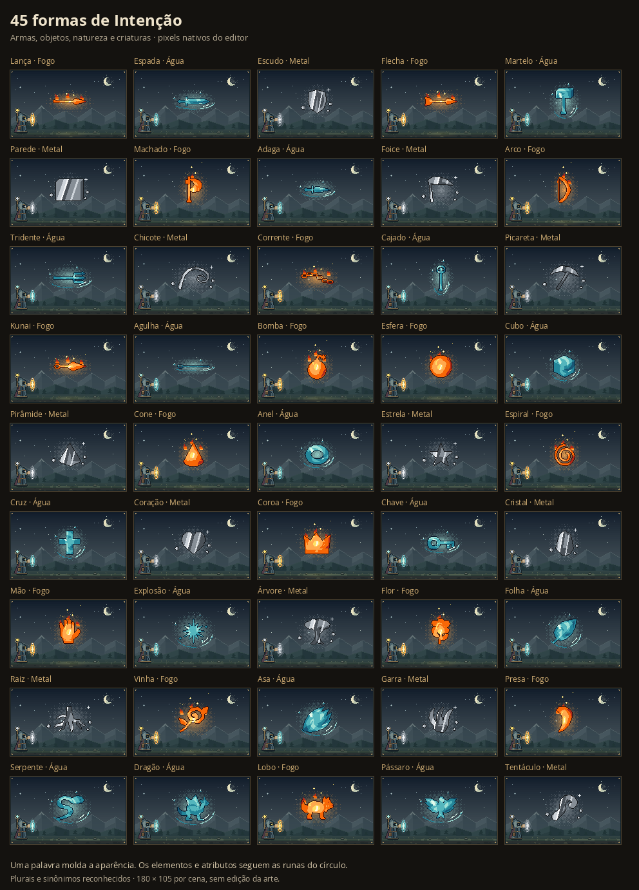

# Mais palavras com formas próprias

O vínculo «bomba» antes desenhava os caracteres da palavra. Agora gera uma bomba em pixel art, com corpo, pavio e faísca feitos do material da magia. O catálogo passou de sete para **45 silhuetas**, reconhecidas por **279 palavras distintas após normalizar acentos e caixa**, incluindo plurais e sinônimos explícitos.

## Formas

| Grupo | Silhuetas |
| --- | --- |
| Armas | Lança, espada, escudo, flecha, martelo, machado, adaga, foice, arco, tridente, chicote, corrente, cajado, picareta, kunai e agulha |
| Objetos e geometria | Parede, bomba, esfera, cubo, pirâmide, cone, anel, estrela, espiral, cruz, coração, coroa, chave, cristal, mão e explosão |
| Natureza e criaturas | Árvore, flor, folha, raiz, vinha, asa, garra, presa, serpente, dragão, lobo, pássaro e tentáculo |

Sinônimos usam silhuetas genéricas da mesma família: «granada» usa Bomba; «sabre» usa Espada; «cipó» usa Vinha. Plurais também escolhem a mesma forma, sem multiplicar a magia. Uma segunda Intenção numérica continua indicando quantidade.

## Uso no editor

No campo de Intenção, a seção recolhida **45 formas ilustradas** permite pesquisar nome, categoria ou sinônimo. Escolher uma opção apenas preenche o campo e atualiza a leitura; **Vincular** mantém a confirmação existente. Depois de confirmar, o catálogo continua consultável, com as opções bloqueadas até trocar a runa.

A busca aceita «granadas», «DRAGOES» ou «cristais». A vinculação continua limitada a uma palavra ou inteiro positivo por runa, sem aproximar substrings ou aceitar frases. Palavras fora do catálogo preservam o desenho tipográfico existente.

## Arte e regras

Todas as novas formas são polígonos rasterizados pelo mesmo painter e recebem `materialPixel`: nenhuma lâmina, cabo, planta ou criatura força madeira, metal ou outra matéria. Elementos, estados, origem, direção, Projétil, Área, Órbita e Ser permanecem determinados pelas runas. Uma bomba não ganha dano explosivo automaticamente, uma asa não cria voo e um dragão não cria vida.

Os sete desenhos anteriores permanecem intactos. O catálogo define artigos em português para a descrição, como «uma bomba», «um dragão» e «um cristal». Nenhuma migração de projeto, alteração de energia ou nova regra de custo foi introduzida.

## Validação

Testes cobrem as 45 formas, todos os aliases, consulta exata, gêneros, persistência, escolha sem vínculo automático, catálogo bloqueado, pixels e limites de desenho. O layout verifica cada forma nos seis destinos, com e sem Projétil, quantidades, oito órbitas e preservação das entradas. A conferência visual inclui Fogo, Água e Metal e o caso de bomba multimatéria em Área mostrado na imagem enviada.

- **1.056 testes aprovados**, em 32 arquivos, com TypeScript e build Vite aprovados.
- 45 formas × três materiais × dia/noite: 270 cenas nativas conferidas.
- As 42 imagens de referência das sete formas originais são idênticas, byte a byte, às anteriores.
- Os 45 presets mantêm a mesma interpretação, propriedades e estatísticas; três SVGs e três PNGs dos círculos também permanecem idênticos.
- Revisão independente do catálogo, artigos, consulta exata, segurança e seleção sem vínculo automático: sem bloqueios.
- Fluxo real de bomba, «dragão»/«DRAGÕES»/«dragonete», três bombas, escopo por Ser, troca de runa, desfazer/refazer e salvar/reabrir aprovado. Os pixels persistidos são os mesmos ao reabrir.
- Catálogo e prévia ampliada conferidos em desktop e celulares de 320/390 pixels, sem erros de página ou transbordamento. Catálogo aberto mede 270/270 e 340/340 pixels de largura disponível/ocupada.
