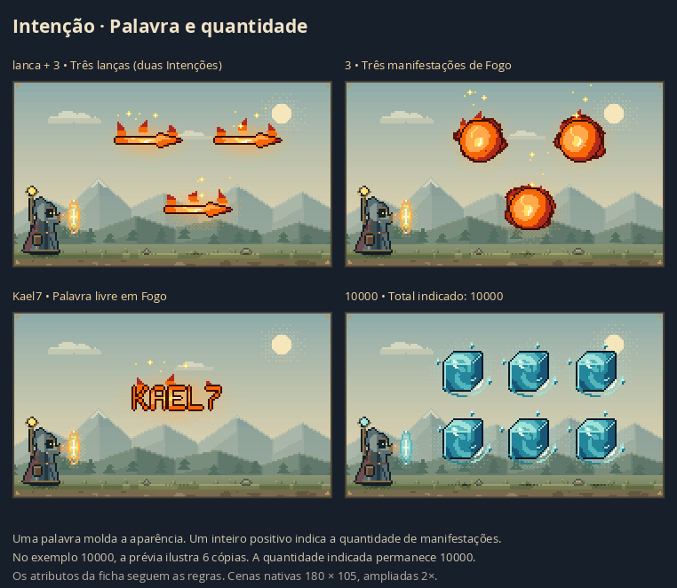

# Intenção livre e quantidade

Este registro descreve a implementação inicial. O catálogo foi ampliado para **45 formas e 279 palavras**; consulte [a expansão do catálogo](intention-catalog-review.md) para o estado atual.

A Intenção aceita uma palavra ou um inteiro positivo por vínculo, com o limite existente de 40 caracteres. A palavra define a aparência; o número indica quantas manifestações devem aparecer. O desenho das runas e dos círculos permanece no renderer original.

## Comportamento

- «lança» e «lanca» geram a mesma silhueta, feita do elemento já escolhido.
- Espada, escudo, flecha, martelo, parede e machado também têm silhuetas próprias. O vocabulário não é uma lista de valores permitidos: outras palavras são desenhadas por inteiro, com letras em pixel art feitas do material da magia.
- A fonte bitmap normaliza acentos apenas no desenho e mantém o texto original no vínculo, legenda e descrição acessível. Caracteres sem glifo no alfabeto bitmap aparecem como `?`; não se gera uma aproximação falsa de outro sistema de escrita.
- «3» produz três cópias da manifestação completa. Um vínculo de palavra e outro de quantidade no mesmo grupo podem produzir, por exemplo, três lanças.
- Inteiros grandes preservam o valor exato como string. A cena ilustra até seis cópias por manifestação e mostra o total com aviso de amostragem.
- Zero, negativos, decimais, frases, marcação HTML e entradas acima de 40 caracteres não podem formar novos vínculos. Palavras compostas com hífen/apóstrofo e palavras alfanuméricas são aceitas.
- A validação da nova vinculação não impede abrir projetos antigos. Frases antigas são mantidas como vínculos textuais, sem conversão automática em uma forma.
- O alvo continua sendo a identidade física da runa, seu Ser ou círculo anterior. Outras manifestações do mesmo Fogo ou Esfera não herdam o vínculo por coincidência de nome.
- Conceitos puros permanecem como auras; uma quantidade pode repetir a aura sem criar matéria sólida.
- Havendo várias palavras ou quantidades no mesmo alvo, a primeira de cada tipo na ordem existente é usada. Quantidades não se multiplicam entre si.

## Regras e persistência

`intentForm`, `intentGlyph`, `intentCount` e `intentBonds` são derivados dos vínculos salvos. Não há migração de schema nem nova informação obrigatória no projeto. A expansão em cópias acontece somente na cena e não muda o modelo, formatos, estado, trajetos ou cálculos da ficha. Energia e poder continuam determinados pelas regras existentes; o RPG ainda não definiu um custo por cópia.

Os 45 exemplos existentes foram comparados ao código anterior: 43 mantêm a mesma interpretação visual; «Esconder» e «Hostil» passam a ter os caracteres desenhados, como esperado para o vocabulário aberto. Os elementos, formatos e propriedades desses dois exemplos permanecem intactos.

## Validação

Os testes automatizados cobrem palavras livres, normalização, limites, quantidades exatas grandes, alvo por Ser/círculo/fonte, combinação de palavra e quantidade, preservação de estatísticas, determinismo dos pixels, distribuição de cópias, órbitas e todos os destinos. A conferência no navegador inclui a vinculação real com confirmação, desfazer/refazer, troca de runa, exportação/reabertura e telas estreitas.

- `npm test`: **745 testes aprovados**, em 27 arquivos.
- `npm run build`: TypeScript e compilação Vite aprovados.
- Revisão independente do núcleo, persistência e quantidade: sem bloqueios restantes.
- Layout: 102 casos aprovados, incluindo oito palavras de 40 letras em órbita, sem ocultar corpos ou relaxar o limite esperado de escala.
- Navegador: 30 casos, com propriedades, estatísticas e efeitos preservados; 45 presets também mantêm esses dados. Doze exportações SVG/PNG dos círculos são idênticas ao código anterior.
- Fluxo real: vincular lança/palavra livre/quantidade, três lanças com duas Intenções, escopo por Ser, desfazer/refazer e exportar/reabrir aprovados.
- Mobile de 320 e 390 pixels, temas claro/escuro e prévia ampliada aprovados. Vínculo de 40 dígitos quebra linha no inspetor, sem ultrapassar a largura disponível (270 e 340 pixels).
