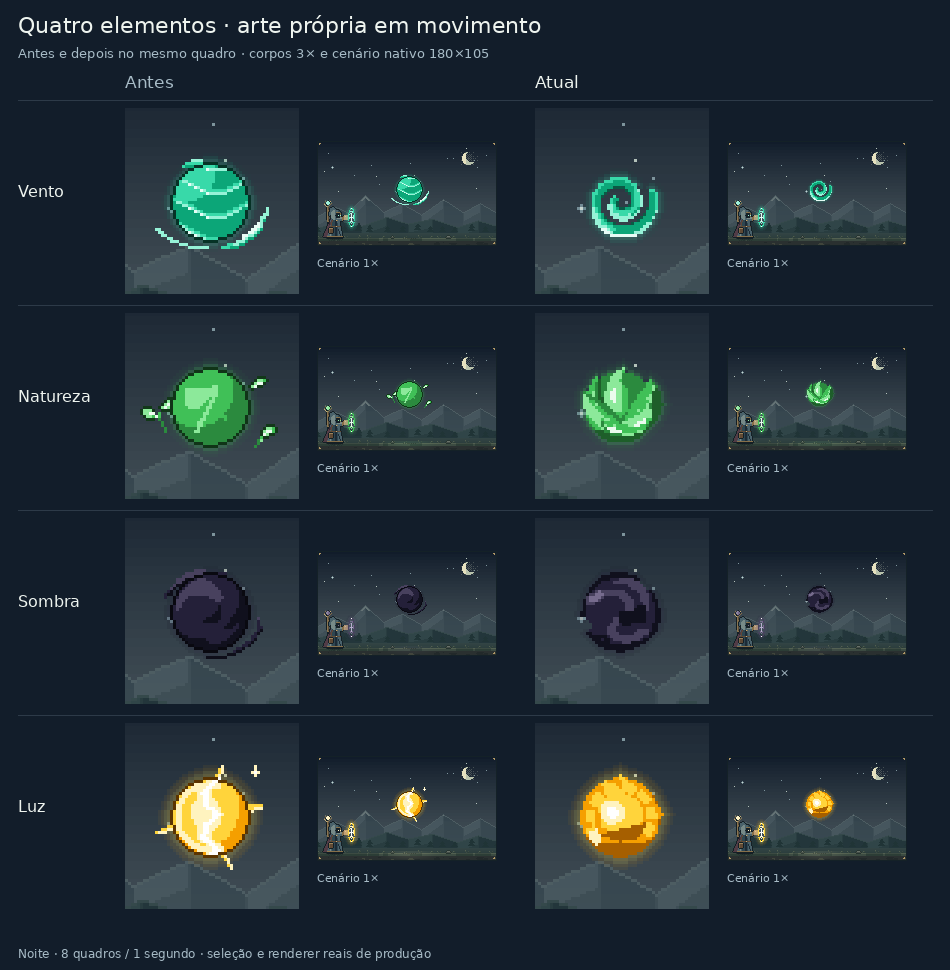

# Vento, natureza, sombra e luz

Esta etapa parte de `88fc8789`, a versão com as misturas coesas e o lança-chamas contínuo. O trabalho está no desenho das quatro esferas puras e em seus oito quadros de animação.

Este registro descreve a etapa concluída em `0c1bf32c`. A revisão seguinte das misturas tem comparação e validação próprias em [Junções entre elementos](element-junctions-review.md).

| Elemento | Desenho e movimento |
| --- | --- |
| Vento | Uma faixa de ar enrolada, com canais vazios, recuo jade e ombro claro. A corrente gira com iluminação fixa. |
| Natureza | Uma semente protegida por folhas dobradas. As pontas abrem e recolhem, e a seiva percorre as nervuras. |
| Sombra | Duas massas de fumaça com dobras em S, núcleo escuro e uma crista púrpura curta que percorre a dobra. |
| Luz | Volume dourado com base ocre, núcleo branco pequeno e uma faixa luminosa que acelera pelo arco e esfria no fim. |

Os corpos usam as paletas existentes e a resolução nativa de 180×105. Os recortes das prévias são ampliados por vizinho mais próximo, mantendo as bordas dos pixels. O relógio, a pausa e o movimento reduzido continuam a cargo do controlador existente.

A seleção exige um único elemento, uma única esfera e ausência de forma ou glifo de Intenção. As rotas das misturas, dos pares autorais, das montagens e das intenções permanecem preservadas. As runas e os desenhos dos círculos do editor não foram alterados.

## Comparação com a versão anterior



[Animação antes/depois](visuals/living-elements/comparison-night.gif) · [Comparação durante o dia](visuals/living-elements/comparison-day.png) · [Cópias, órbitas, retorno e conceitos](visuals/living-elements/contexts-night.gif)

A prova usa um renderer congelado antes da mudança, com SHA256 `041085311b3bdbcd1f5143961759d0ec4e551cce29ba243964aca3aeada3927a`. O renderer atual é compilado diretamente das rotas de produção. O script registra os hashes das fontes e das capturas no [manifesto](visuals/living-elements/manifest.json).

- 768 capturas nos dois temas e nos oito quadros, incluindo corpo principal, lançamento, retorno, seis manifestações, oito órbitas e conceitos.
- 3.840 verificações de limites, 384 verificações de ciclo e 2.304 verificações de borda e de preservação dos dados de entrada.
- 48 controles fora desta etapa, com 768 comparações de pixels idênticos à versão anterior. Incluem as 12 dominâncias dos seis pares já aprovados e o lança-chamas.
- GIFs com oito quadros e ciclo de um segundo; uma paleta global por animação evita mudanças de cor entre quadros. Os PNGs preservam as cores exatas.

## Reprodução

Em um checkout de `88fc8789`, após `npm ci`, congele a base com:

```sh
node --input-type=module -e 'import {build} from "esbuild"; await build({stdin:{contents:"export {renderPixelScene,PW,PH} from \"./src/ui/pixel-scene\"; export {appearanceForScene,layoutScene,boundsOfBeing} from \"./src/ui/pixel-scene-layout\"; export {spellSpriteOf,paintSpellSprite,spellSpriteBounds} from \"./src/ui/pixel-spell-sprites\"; export {pairSpriteOf} from \"./src/ui/pixel-pair-sprites\";",resolveDir:process.cwd(),loader:"ts"},bundle:true,platform:"node",format:"esm",outfile:"/tmp/living-baseline.mjs"});'
```

Na versão desta etapa (`0c1bf32c`), execute:

```sh
npm ci
npm run typecheck
npm test -- --maxWorkers=2
npm run build
npm audit --audit-level=low
node scripts/proof-living-elements.mjs docs/visuals/living-elements --baseline /tmp/living-baseline.mjs
```

O compositor usa Pillow, já usado pelas outras provas visuais do repositório. A prova elimina os rasters temporários depois de gerar as imagens e não altera as fontes.

## Validação

A suíte completa de 74 arquivos, TypeScript, build de produção e auditoria sem vulnerabilidades passaram. As prévias foram inspecionadas nos oito quadros, no tamanho nativo e ampliado, em ambos os temas.

A geometria das oito poses de natureza é reutilizada, e as nervuras são calculadas apenas na folha visível. A otimização manteve 8.424 renders idênticos byte a byte, incluindo três paletas, posições fracionárias e recortes nas bordas. Um teste adicional intercala paletas e poses para conferir a independência das cores.

A validação visual é a saída real do renderizador. Não houve uma nova sessão interativa de navegador ou medição em celular nesta etapa.
