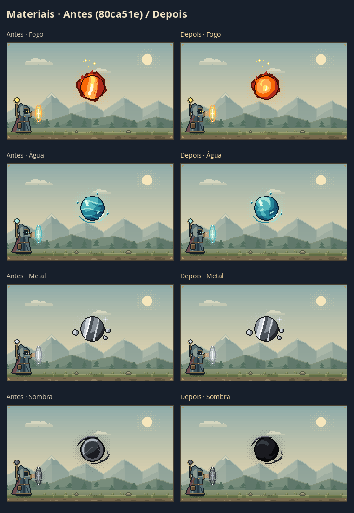
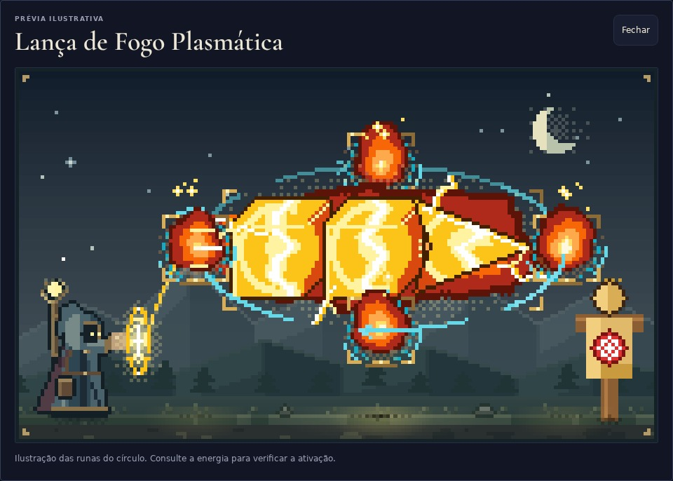

# Magias em pixel art

A arte dos efeitos usa blocos de cor, planos de luz e texturas próprias para cada material. A resolução permanece em 180 × 105 pixels, ampliada sem suavização. O fogo tem corpo volumétrico e filamentos curvos; a água tem correntes em espiral; sombras ficam escuras e natureza ganha nervuras internas. Peças consecutivas têm padrões próprios. Cubos e pirâmides conservam a geometria, e as ligações iluminam as emendas sem cobrir o corpo inteiro com uma faixa branca.

| Elemento | Aparência |
|---|---|
| Fogo | Núcleo marfim, camadas quentes, pequenas línguas ligadas ao corpo e brasas |
| Raio / Luz | Correntes ramificadas para eletricidade; feixes retos para luz |
| Água / Ácido | Ondas turquesa e gotas para água; bolhas para ácido |
| Gelo | Planos cristalinos e lascas facetadas |
| Terra / Metal | Manchas minerais e fissuras; faixas de reflexão para metal |
| Vento / Som | Fitas abertas e frentes de onda |
| Natureza / Vida | Ramos, folhas e pequenos brilhos |
| Sombra / Espaço / Ilusão | Corpo escuro e névoa; arcos e fragmentos espectrais |

## Comparação

Referência: `80ca51e`. As imagens abaixo vêm do próprio renderizador, com as mesmas entradas antes/depois e ampliação de 2× por vizinho mais próximo. O cenário é o mesmo. Veja também [como as runas estruturais moldam as magias](structural-magic-review.md).

## Verificações

- 547 testes e build aprovados. Cobertura de escopo, geometria, paletas, luz, blocos de cor, determinismo, entradas sem mutação, moldura e efeitos secundários.
- 52 cenas em dia/noite revisadas visualmente: materiais, estruturas, conceitos, projeções, retorno, magias compostas e exemplos reais. As partículas deixam as silhuetas reconhecíveis.
- Os 45 exemplos foram comparados: 36 aparências idênticas e 9 correções de fechamento por Ser, separação de grupos, formato duplicado ou Toque sem alvo anterior. As duas cenas vazias continuam idênticas pixel a pixel. Detalhes no relatório estrutural.
- 12 exportações dos círculos, SVG e PNG de três magias nos dois temas, idênticas byte a byte à referência.
- Prévia real em Chromium, no computador e em celulares de 390 e 320 px, sem erros de JavaScript ou transbordamento horizontal observado. Capturas com dados de demonstração.

O desenho das runas e dos círculos continua preservado; as correções alinham a prévia ao alcance definido pelas regras estruturais.
