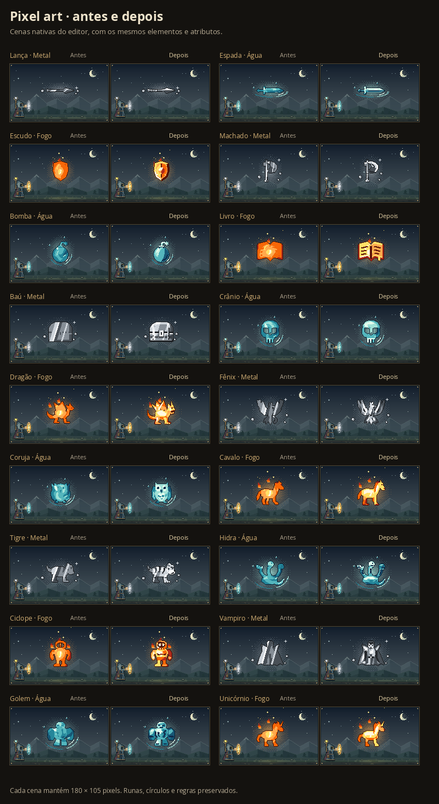
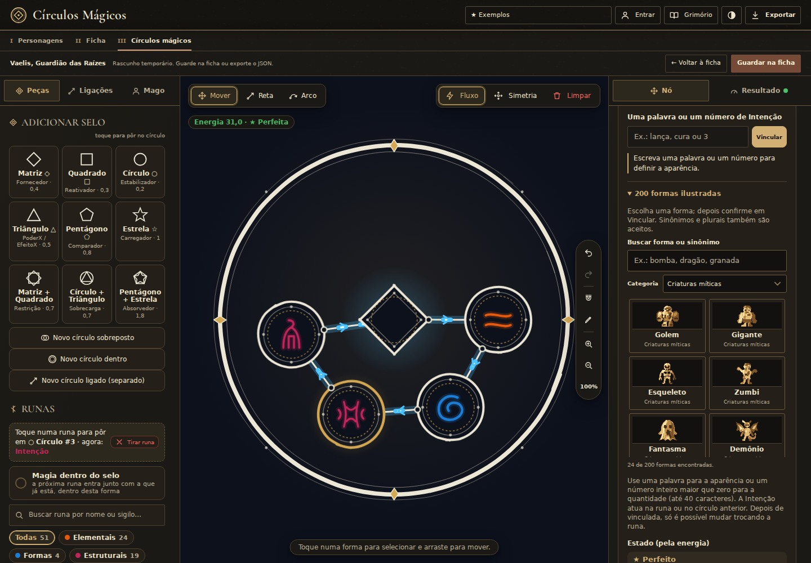

# Pixel art com detalhes e volume legíveis

Esta página registra o primeiro refinamento de 46 desenhos. A revisão seguinte cobre [todos os 200 sprites e os corpos básicos](all-spell-sprites-review.md).

Os reflexos largos do metal e o núcleo luminoso do fogo encobriam olhos, rostos e gravuras das formas de Intenção. A iluminação agora respeita os planos e detalhes desenhados em cada silhueta. As 200 formas recebem esse tratamento, e 46 desenhos também ganharam acabamento geométrico.

## Desenhos refinados

| Grupo | Formas |
| --- | --- |
| Clássicas (7) | Lança, espada, escudo, flecha, martelo, parede e machado |
| Objetos (16) | Bomba, mão, cristal, coroa, livro, armadura, manopla, baú, barril, caixão, espelho, moeda, harpa, violino, flauta e tambor |
| Fauna (12) | Dragão, lobo, pássaro, serpente, cavalo, coruja, coelho, elefante, crocodilo, polvo, tigre e pavão |
| Criaturas míticas (11) | Fênix, grifo, quimera, hidra, golem, esqueleto, fantasma, centauro, minotauro, vampiro e ciclope |

Armas têm lâminas, biséis, ressaltos e empunhaduras mais definidos. Objetos ganharam fechos, páginas, aros, juntas e cavidades. Criaturas receberam olhos, focinhos, penas, articulações e membros separados; os quatro cascos do centauro, antes parcialmente sobrepostos, agora são distintos. A comparação considera os tamanhos 15 e 7,5 usados pela pintura do editor.

## Materiais

`intentionMaterialPixel` reaproveita a amostragem de `materialPixel` e remapeia o índice da paleta com a luz autorada. Olhos e entalhes escuros não recebem o reflexo claro da superfície. Facetas iluminadas e sombreadas continuam separadas, enquanto correntes, reflexos e variações de semente permanecem visíveis em blocos de cor.

Só são usadas cores da paleta recebida: sem pele, madeira ou metal de cor fixa, suavização ou pontilhado alternado. Água continua Água e Fogo continua Fogo. Sombra, Morte e Vazio mantêm seus tons escuros. O shader original das formas comuns e do cenário permanece intacto; o novo tratamento é chamado somente pela pintura das silhuetas de Intenção.

Os sete desenhos clássicos ficam em uma tabela própria, com as mesmas caixas autorais anteriores. Todas as demais formas continuam usando a mesma geometria para layout e pintura, incluindo o contorno de um pixel e as aberturas transparentes. O chunk das tabelas de geometria exclui os módulos de material e glifos.

## Compatibilidade e validação

O catálogo permanece com **200 IDs e 1.103 palavras**, incluindo os mesmos sinônimos, plurais e sugestões de grafia. Nenhuma regra, custo, atributo, elemento, direção, quantidade, escopo de Ser ou formato de projeto foi alterado. As runas e os círculos mantêm os desenhos existentes.

- **2.219 testes aprovados**, em 34 arquivos; TypeScript e build Vite aprovados.
- 41 testes específicos verificam a paleta fornecida, contraste dos detalhes e facetas, blocos conectados, oito materiais distintos com a mesma paleta, sementes e variantes escuras.
- Testes de todas as 200 formas verificam determinismo, pixels dentro dos limites, máscaras distintas, espelhamento, seis destinos, Projétil, quantidades e órbitas.
- Revisão independente: 46 geometrias refinadas, 200 IDs e 16.830 pontos conferidos, sem coordenadas ou iluminação inválidas.
- 1.200 cenas de Intenção comparadas em Fogo/Água/Metal e dia/noite. As imagens mudam; os dados de aparência e atributos dos 600 casos permanecem idênticos.
- 45 presets e suas 90 prévias, 96 imagens das formas comuns em oito materiais e seis exportações de círculos permanecem idênticos à referência anterior.
- Stress de 3.200 layouts e 6.400 corpos, sem cortes ou alteração das entradas; mais 150 cenas conferem gelo, sombras e variantes escuras.
- 20 verificações de interface e 36 capturas em desktop e celulares de 320/390 px, nos temas claro e escuro: catálogo, sugestões, quantidade, Ser, salvar/reabrir e prévia ampliada aprovados, sem transbordamento ou exceções JavaScript.
- Versão compilada validada em 1440 e 320 px sob `/c-rculo-magico/`, do acesso como convidado à vinculação e prévia. Arquivos locais responderam HTTP 200 e coincidiram com o build. Google Fonts e consulta externa de regras estavam indisponíveis no ambiente e usaram o fallback existente; autenticação remota não foi validada nesse smoke.
