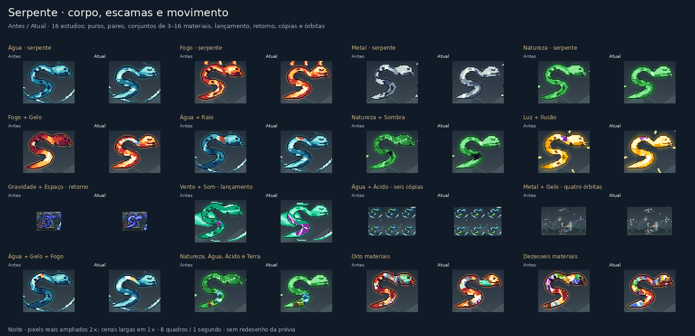

# Serpente e acabamento das misturas

Esta revisão continua `8f1780f12b964ea253e9133de3b47bd51f55475b`. A serpente recebe um corpo em S mais contínuo e afilado, planos de ventre, escamas esparsas, crista dorsal e uma cabeça com sobrancelha, olho, narina, mandíbula e língua bifurcada. Os vazios das curvas fazem parte da silhueta. A luz percorre o corpo em oito quadros; a geometria e o alfa ficam estáticos durante o ciclo.

Uma pose de referência da serpente mantém as regiões de material presas à anatomia enquanto os realces respiram. O cache inclui também o identificador do elemento, evitando que apresentações com paletas iguais e texturas diferentes reutilizem a referência errada.

O acabamento das misturas diferencia a resposta de cada material no contato. Água forma uma borda clara e um canal interno; Ácido acompanha a mesma frente com um movimento mais viscoso. Metal, Gelo e Terra mantêm facetas rígidas com reflexos ou juntas molhadas. Natureza recebe nervuras junto à junção, enquanto Sombra, Gravidade e outros campos aprofundam recessos. As cores refletidas permanecem na borda de contato, sem uma média de todas as paletas sobre o sprite.

Em formas compostas muito pequenas, uma região ausente pode receber um componente inteiro ainda exclusivo do primeiro material. A doação só ocorre se respeitar o orçamento mínimo e mantiver a região principal pelo menos tão grande quanto cada outra. As âncoras e a ordem canônica determinam a escolha, sem oscilar entre os quadros. Isso recupera cores ocultas em algumas correntes e flautas em miniatura.

A composição continua atendendo aos 16 materiais físicos. As runas de conceito continuam auras. A resposta visual de fusão depende dos elementos confirmados em `materialFusion`; esta revisão não acrescenta uma regra de combinação ao RPG.

## Exemplos de produção



[Serpentes animadas](visuals/serpent-mixtures/serpent-night.gif) · [Outras misturas animadas](visuals/serpent-mixtures/mixtures-night.gif) · [Manifesto visual](visuals/serpent-mixtures/manifest.json)

As galerias comparam o renderer anterior congelado com as fontes reais da revisão, sem reescrever rotas ou pintar uma prévia separada. São 16 estudos de serpente e 16 exemplos adicionais de armas, proteção, plantas, criaturas, construções, palavra, esfera e conjunto. As serpentes incluem materiais puros, pares e conjuntos de três, quatro, oito e dezesseis materiais, além de lançamento, retorno, cópias e órbitas. Cada caso é capturado nos oito quadros durante o dia e à noite.

Os PNGs conservam as cores RGB dos recortes. As ampliações usam o vizinho mais próximo; cenas mais largas ficam em escala nativa. Os GIFs usam uma paleta compartilhada pelos oito quadros e um ciclo de um segundo. A codificação ocorre em arquivo temporário; o resultado completo e verificado substitui o destino de forma atômica.

## Verificações e limites

A suíte completa local passou com **3.220 testes em 93 arquivos**. Depois da correção adicional da chave de cache da serpente, os **20 testes em dois arquivos** de cache e integração passaram novamente. O build final de produção passou, e a auditoria de dependências não encontrou vulnerabilidades. A contagem final do CI é registrada no PR.

A prova visual passou com **1.024 capturas**, **736 comparações exatas de cena**, **2.912 verificações de limites** e **2.496 verificações de entrada, borda e ciclo**. As 16 cenas de serpente mudaram e apresentam oito quadros distintos; 15 dos 16 exemplos adicionais mudaram. A armadura de Terra e Metal desta amostra permaneceu idêntica: seu contato rígido não recebe uma mudança visível nesta composição. As dez duplas autorais e os controles puros conservaram os pixels anteriores. Os oito PNG/GIF somam 3.270.563 bytes.

O controle direto das outras 199 formas usa as mesmas 16 paletas, materiais, tamanho 15, seed e duas direções nas versões anterior e atual. As **6.368 comparações** passaram com raster e limites idênticos. O hash agregado anterior e atual é `423a12c2f296f1a690f40c2d4a9665a6dcbfbef81658998e258d6a94406748c3`, sem publicar milhares de imagens. A comparação de cena também conserva controles das 20 dominâncias das dez duplas com desenho próprio, das 16 esferas puras e de dez outras formas puras.

A prova verifica entradas imutáveis, limites conservadores, bordas da cena e repetição exata no quadro `frame + 8`. Seus hashes registram o bundle congelado, o bundle atual, cada fonte importada, os scripts e os artefatos finais. Não há captura interativa de navegador nem medição de FPS ou desempenho em celular nesta prova.

O [novo relatório do catálogo](visuals/serpent-mixtures/catalog-validation.json) concluiu **61.192 fixtures**, **69.616 renderizações de cena**, **56.832 probes de corpos transparentes** e **8.424 verificações de ciclo**, sem falhas. Inclui o cruzamento completo dos 240 pares ordenados com as 200 formas, os 560 trios numa forma representativa e amostras de misturas com quatro, oito e dezesseis materiais, palavras, conceitos, cópias e órbitas. Os probes transparentes são separados das cenas de produção; os metadados de fusão desse eixo são sintéticos e não substituem os testes do interpretador de círculos.

As perdas de material em miniaturas caíram de 40 para **16 slots**: Chicote Fogo/Sombra e Chicote Gravidade/Terra, ambos no tamanho 4, nos oito quadros. Corrente Fogo/Matéria, Corrente Gravidade/Água e Flauta Sombra/Metal recuperaram o segundo material. Os dois chicotes mantêm ambos os materiais no tamanho normal; a limitação nessa escala decorre da política de regiões e primazia adotada, sem afirmar que outra composição visual seria impossível.

As galerias são amostras visuais, não uma enumeração de todas as ordens e subconjuntos de materiais em cada sprite. Cor presente não garante que uma assinatura seja legível em uma cópia de poucos pixels. As proteções de olhos, cortes e realces continuam limitando a área disponível para recoloração; o relatório de catálogo registra essas limitações em vez de escondê-las.

## Reprodução

Congele o renderer em um checkout de `8f1780f12b964ea253e9133de3b47bd51f55475b`, após `npm ci`:

```sh
node --input-type=module <<'JS'
import { build } from 'esbuild';
await build({
  stdin: {
    contents: `export {renderPixelScene,PW,PH} from './src/ui/pixel-scene';
      export {appearanceForScene,layoutScene,boundsOfBeing} from './src/ui/pixel-scene-layout';
      export {pairSpriteOf} from './src/ui/pixel-pair-sprites';
      export {spellSpriteOf} from './src/ui/pixel-spell-sprites';
      export {paintIntention,intentionBounds} from './src/ui/pixel-intention';
      export {paintAllocatedMixture} from './src/ui/pixel-mixture-compositor';
      export {Pix} from './src/ui/pixel';`,
    resolveDir: process.cwd(), loader: 'ts'
  },
  bundle: true, platform: 'node', format: 'esm', outfile: '/tmp/serpent-baseline.mjs'
});
JS
```

Na revisão nova, depois de instalar as dependências:

```sh
node scripts/proof-serpent-mixtures.mjs --baseline /tmp/serpent-baseline.mjs
node scripts/check-universal-mixtures.mjs --output /tmp/serpent-catalog.json
```

O script requer Python com Pillow, remove as capturas RGBA temporárias ao terminar e publica somente os oito PNG/GIF e seu manifesto. O hash do bundle congelado usado nesta revisão é `a6e9a67342fcc8531d3a8b565138a620dff46970a6f0a0c1a9d86c0e304a171a`.
