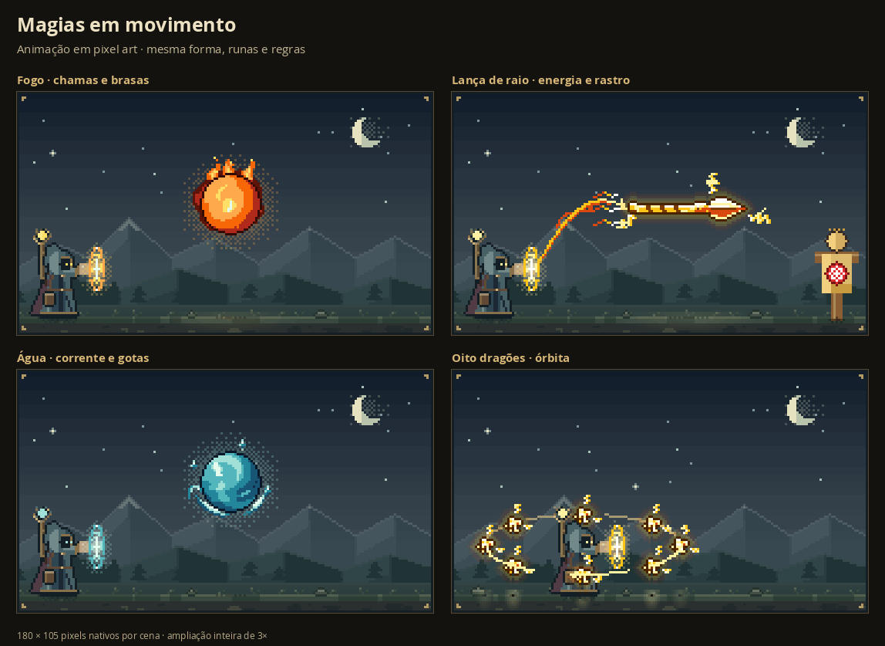

# Magias em movimento

A prévia e a janela ampliada agora mostram efeitos animados em pixel art. As chamas se curvam, as brasas sobem, a água ondula e a energia percorre as trajetórias de lançamento e retorno. Os raios variam seus canais em um único quadro do ciclo, sem piscar o cenário inteiro.

## Reprodução

- O ciclo tem oito quadros, reproduzidos a oito quadros por segundo.
- O botão **Pausar / Animar** controla a mesma reprodução nas duas prévias.
- A animação para fora da tela, nas outras páginas do RPG e quando a aba do navegador fica oculta.
- A preferência de movimento reduzido inicia a prévia pausada. O usuário pode escolher **Animar**; uma nova mudança para movimento reduzido volta a pausá-la.
- Pausar preserva a escolha ao trocar de magia. Um círculo vazio mantém os controles desativados.

O corpo das Intenções, as palavras, o cenário e as legendas permanecem estáveis. Os efeitos de cópias pequenas respeitam a mesma margem de três pixels. Nesta primeira etapa, o traçado da órbita permanecia fixo e apenas os efeitos elementais recebiam movimento. A revisão posterior de órbita e rastros faz os próprios membros percorrerem a elipse, com ordenação de profundidade e envelope válido durante todo o ciclo.

## Desempenho e validação

O quadro inicial reutiliza as duas imagens estáticas. Os demais quadros são gerados apenas quando necessários, no tema visível, e depois reutilizados. O cache guarda até 16 imagens da aparência atual; trocar a aparência descarta o cache anterior. Um único relógio atende à prévia e à ampliação. Nomes, fichas e diagnósticos não são recalculados a cada quadro.

- `npm test`: 2.461 testes em 41 arquivos aprovados.
- `npm run build`: tipos e compilação de produção aprovados.
- Os 114 PNGs iniciais de 57 cenas, incluindo os 45 exemplos, são idênticos ao acabamento estático do commit `53b2bab9f07cc4555c81fd29f217e476f10ff238`.
- Os oito quadros das 57 cenas nos dois temas totalizam 912 PNGs verificados; 70.560 pixels dos corpos acompanhados permanecem iguais durante o ciclo.
- O ciclo volta ao mesmo quadro após oito passos, sem alterar interpretação, valores ou legendas.
- Testes verificam direção dos rastros, preservação de corpos, limites das partículas, cache, pausa, movimento reduzido, visibilidade, troca de tema e limpeza dos observadores.
- Em Chromium com viewport 390 × 844 e CPU reduzida em quatro vezes, os 32 quadros iniciais de quatro demonstrações tiveram mediana de 32,9 ms e percentil 95 de 89,6 ms para renderizar e gerar o PNG. É uma medição em emulação, não em um aparelho físico; os quadros seguintes usam o cache.

O [refinamento dos efeitos estáticos](spell-effects-review.md) também faz parte desta alteração. Não há novas dependências.
