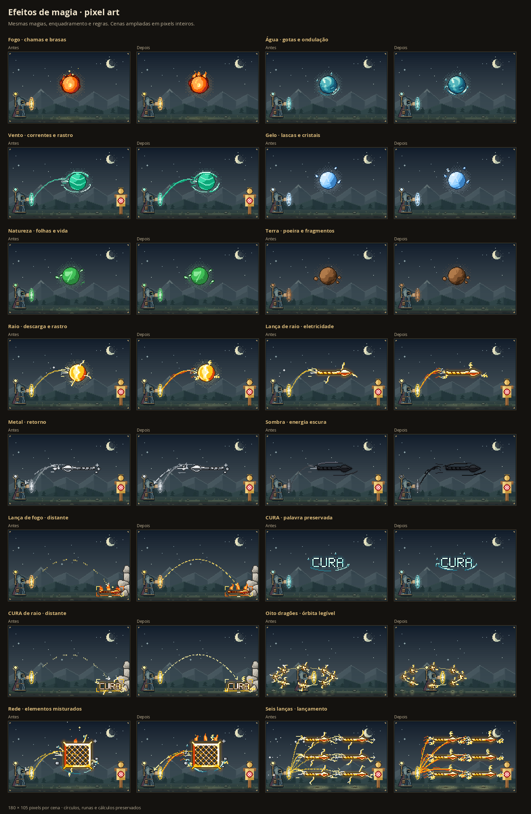

# Efeitos das magias em pixel art

O acabamento descrito aqui também recebeu [animações com pausa e movimento reduzido](spell-animation-review.md). A validação abaixo registra a etapa estática do commit `53b2bab`.

Os efeitos acompanham o material e o movimento da magia, preservando as 200 silhuetas, as palavras e os desenhos das runas e dos círculos. A referência anterior é o commit `3b2e0cdb7fece95bc174615f133ea005af595b08`.

## Acabamento

- Fogo: línguas curvas com dobras quentes e brasas em dois tons.
- Raio e luz: canais assimétricos com ramificações; luz com raios finos e pequenas facetas.
- Água e ácido: cristas com volume, redemoinhos, gotas e espuma facetada.
- Gelo, terra e metal: agulhas de geada, cristais e lascas com faces iluminadas.
- Vento e som: correntes com pontas curvas e frentes de onda distintas.
- Natureza, vida e energias espectrais: folhas, pétalas e dobras escuras. Sombra, morte e vazio usam os tons escuros da paleta.
- Movimento: lançamento com uma esteira estreita, projeção segmentada e retorno com marcas voltadas para o conjurador. As curvas e os destinos continuam os mesmos.

Os efeitos decorativos de corpos menores que 20 pixels ficam na margem de até 3 pixels. As Intenções mantêm a composição pelo contorno: corpo, detalhes e vãos protegidos. As trajetórias passam atrás dos corpos e do mago, inclusive no retorno. As marcas de direção indicam movimento; não representam um acerto automático no alvo.

## Validação

- `npm test`: 2.348 testes em 39 arquivos aprovados.
- `npm run build`: tipos e compilação de produção aprovados.
- 601 casos de Intenção e 45 exemplos mantêm a interpretação, os cálculos, as fichas e as descrições do commit de referência.
- Três exportações SVG e três PNG dos círculos permanecem idênticas byte a byte.
- 639 casos focais, incluindo palavras, misturas, retorno, destinos distantes, seis cópias e oito órbitas, sem mutação ou corte do corpo.
- Interface em 320, 390 e 1440 pixels nos temas claro e escuro: prévia, ampliação e fechamento por Escape aprovados, sem rolagem horizontal.
- Testes específicos verificam determinismo, limites, paletas, direção do retorno e preservação dos pixels de Intenção.

Não há novas dependências ou alterações em regras, quantidades, dano ou persistência.
