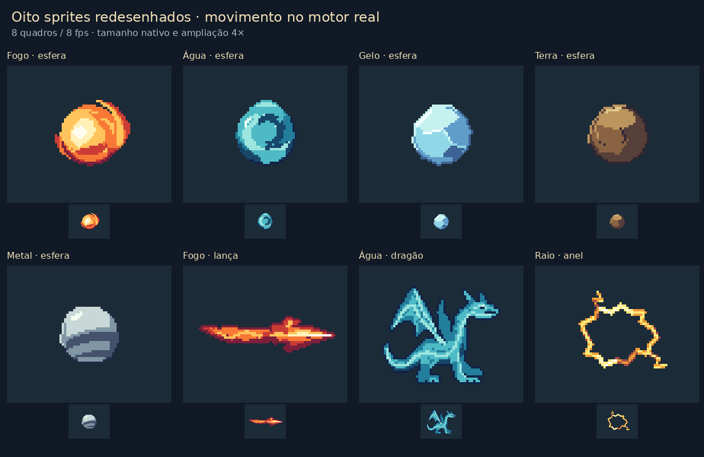
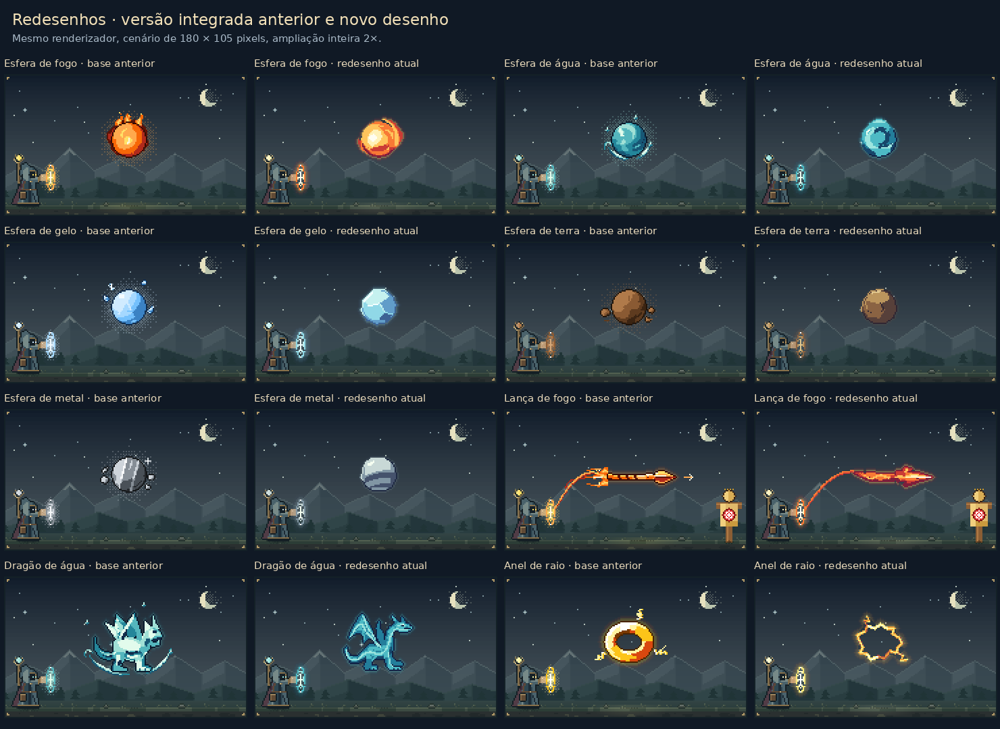
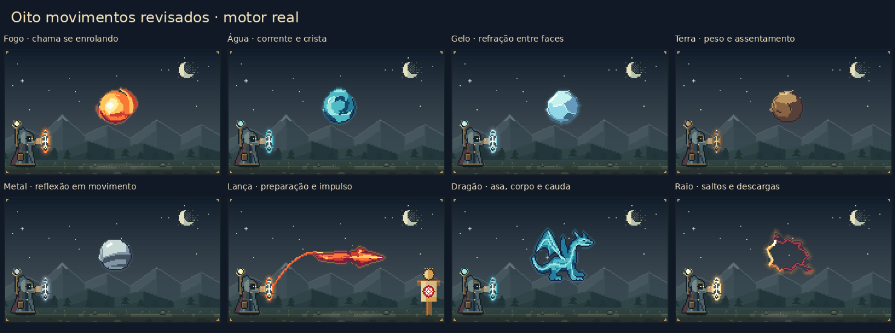
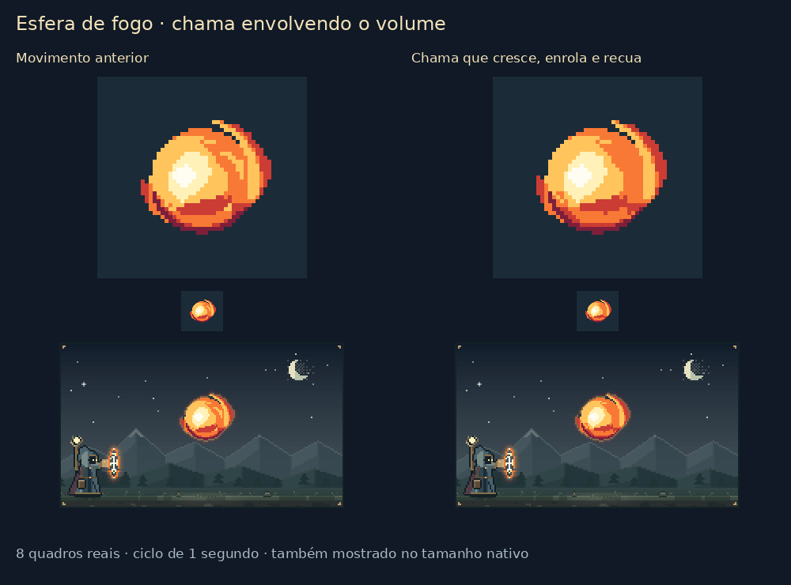
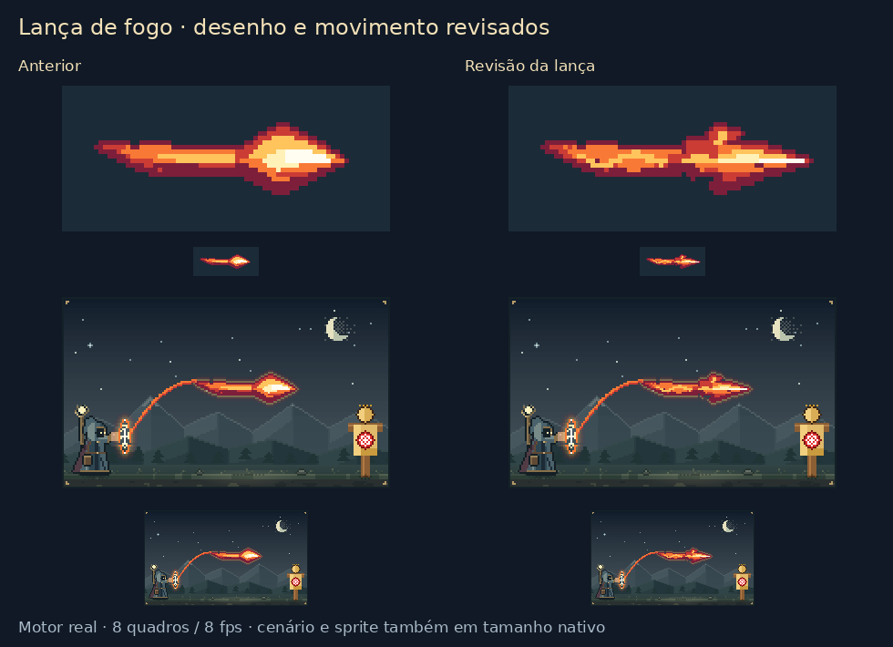
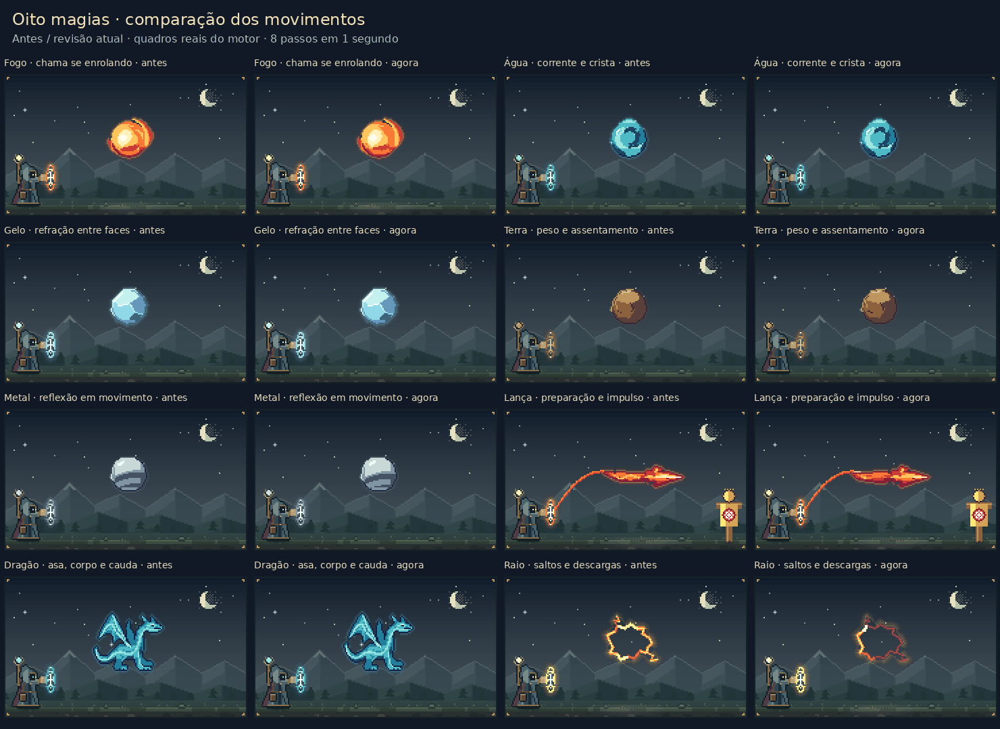
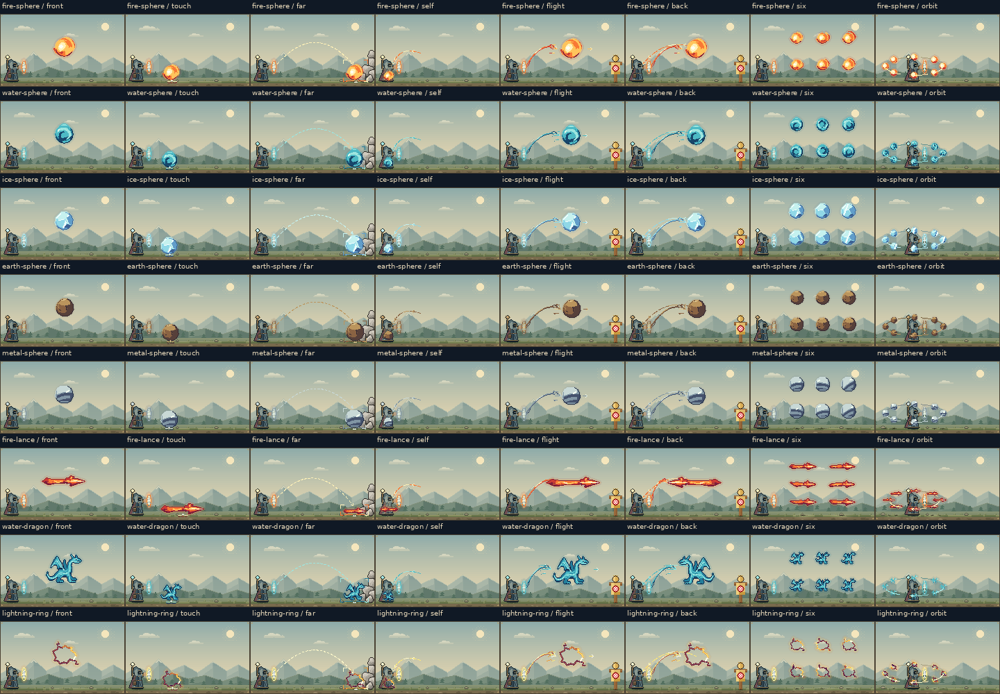
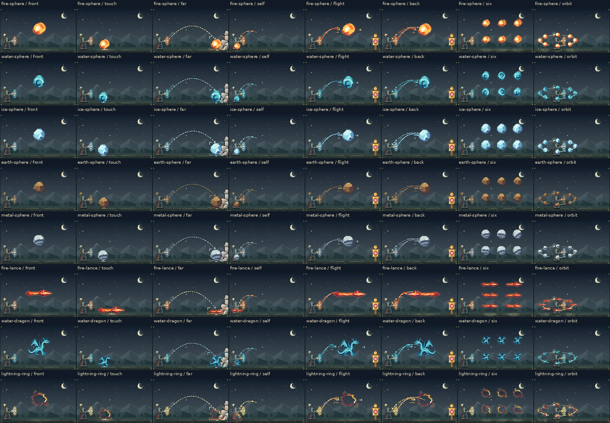

# Redesenho das magias e animações

Base: `2cd36bae16cafb32b6c927cb8da2836dddae8830`, após as integrações de animação e status. Revisão restrita à arte e às animações das magias.

## O que foi redesenhado

O foco deixou de ser apenas paleta e efeitos: estas **oito combinações de forma e material têm construção própria**:

1. Esfera de fogo: massa redonda, núcleo assimétrico único, dobra curva e coroa de chama ligada ao volume.
2. Esfera de água: crista conectada, planos transparentes e corrente interna curva.
3. Esfera de gelo: contorno facetado, três planos amplos e arestas seletivas.
4. Esfera de terra: contorno angular, faces grandes e poucas fissuras.
5. Esfera de metal: volume formado, horizonte refletido escuro e brilho concentrado.
6. Lança de fogo: ponta longa recurvada, ombros assimétricos, plano rebaixado e haste com duas dobras de fogo entrelaçadas.
7. Dragão de água: novo perfil, pescoço em curva, asas enraizadas, cauda contínua e planos dianteiros/traseiros distintos.
8. Anel de raio: circuito estreito e anguloso, centro vazio e duas ramificações presas ao próprio contorno.

As outras formas e combinações continuam com suas silhuetas anteriores, com a revisão geral de materiais, emissão de contorno e efeitos. **Não é um redesenho das 200 Intenções.** Palavras como CURA, misturas de elementos e composições estruturais não são substituídas por estes oito sprites.

Os desenhos são originais, feitos com os pixels do motor. As referências de princípios visuais foram [Wizard of Legend](https://wizardoflegend.com/press/wizard_of_legend/index.html), [Sea of Stars](https://seaofstarsgame.co/) e [Hyper Light Drifter](https://www.heartmachine.com/hyper-light-drifter). Nenhum sprite ou asset desses jogos foi copiado.

## Movimento que pertence ao corpo

- A esfera de fogo mantém o núcleo luminoso enquanto uma frente amarela percorre a face inferior, sobe pela lateral e entra na coroa. A trilha esfria após a passagem.
- O dragão tem faixas de água que mudam posição e espessura ao longo da cauda, quadril, pescoço e membranas. Olhos e cortes do rosto ficam protegidos e acompanham o movimento da cabeça.
- A lança mantém sua silhueta de lâmina. Em voo, recua brevemente e avança com impulso; nas posições ancoradas, só o material e a esteira se movem. Sua trajetória de lançamento entra na esteira; a seta e os ecos paralelos antes soltos foram retirados apenas nessa junção.
- O anel tem descargas locais desfasadas e propagação posterior pelas ramificações. O centro continua aberto.
- Água enrola sua crista e corrente; gelo refrata luz através das faces rígidas; metal gira uma reflexão curva; a rocha inclina e assenta como um corpo sólido.

O relógio existente de oito quadros a 8 fps continua responsável pela animação. Cache de 16 imagens, pausa, movimento reduzido e suspensão por visibilidade não foram duplicados nem alterados. Cópias usam fases locais desfasadas. Não há reinício coletivo de brilho especial no quadro zero.

## Composição e regras

- O caminho normal de `renderPixelScene` usa os novos desenhos, sem chave experimental.
- Layout, contato e cópia das camadas compartilham os limites do ciclo completo de cada sprite.
- Versões pequenas eliminam detalhes subpixel que prejudicariam cópias e órbitas.
- Lança e dragão espelham a silhueta completa no retorno quando a semântica de projétil exige isso.
- Efeitos decorativos ficam fora dos detalhes protegidos; o fluxo de material intencional pode acontecer dentro do corpo.
- O selo e os glifos das runas, interpretação das magias, quantidade, direção, fichas, login e tabela de status não foram redesenhados.

## Evidências e verificação

As imagens vêm dos buffers RGBA reais, com resolução nativa de 180 × 105, ampliados sem suavização. GIFs têm oito quadros reais, sem interpolação. A revisão atual gerou 1.152 cenas nos dois temas e nos oito passos, além de 64 sprites isolados. A comparação inclui frente, voo, Toque, Área/distância, retorno real, seis cópias e oito órbitas.

Verificação da versão final local:

- `npm test`: 48 arquivos, **2.573 testes aprovados**.
- `npm run typecheck` e `npm run build`: aprovados.
- `npm audit --audit-level=low`: nenhuma vulnerabilidade reportada.
- Os 45 presets produzem a mesma interpretação de aparência em JSON que a base.
- Revisão independente: **6.336 amostras de sprites**, cobrindo 11 escalas, quatro origens fracionárias, os oito quadros, ambos os sentidos e lança ancorada/em voo. Nenhum corpo vazio, desconectado ou fora do limite compartilhado.
- Foram renderizados **896 quadros de integração para QA**, cobrindo frente, voo, Toque, Área/distância, retorno real, seis cópias e oito órbitas nos dois temas. A inspeção visual usou folhas de contato representativas e ciclos completos de voo, retorno real, Toque, dragão e anel. Os desenhos mínimos de lança e dragão permanecem conectados.
- Na comparação de compatibilidade com `baeeb50`, 122 de 352 quadros mudam, somente nas oito combinações revisadas. Os outros 230 quadros e os 45 presets permanecem idênticos.
- Asserções de pixels preservam comparação exata de todos os bytes; agrupar as verificações de borda eliminou um timeout causado por milhares de asserções individuais.

### Desempenho local

Medição da primeira integração (`afc401b`), antes da revisão dirigida da lança. Comparação na mesma máquina e processo Node v24.19.0, alternando a ordem base/nova em cinco rodadas. Cada chamada renderiza um quadro sem reutilizar a imagem de cache; não inclui PNG, DOM, navegador ou limitação de CPU. Os resultados abaixo não são uma medição de FPS da interface.

| Conjunto | Amostras por versão | Mediana base → nova | p95 base → nova |
| --- | ---: | ---: | ---: |
| Quatro cenas de referência, oito quadros | 160 | 3,10 → 5,59 ms | 56,77 → 54,16 ms |
| Oito sprites e dois casos de quantidade, oito quadros | 400 | 6,95 → 5,23 ms | 52,98 → 14,76 ms |

Há custos distintos: as esferas simples aumentam a mediana em aproximadamente 0,3–3,0 ms devido ao corpo e ao contorno próprios. Lança, anel e seis dragões ficam mais leves neste teste. O dragão único passa de mediana 30,19 para 9,87 ms, p95 42,61 para 16,44 ms e pico 94,13 para 36,02 ms. Portanto, **não há melhoria uniforme de desempenho**. Uma medição intermediária encontrou p95 de 68,33 ms no dragão novo. A investigação eliminou cálculos de corrente corporal em pixels apenas da asa/traseira e rejeitou testes de polígono fora de seus limites imutáveis. Os 352 quadros de produção ficaram idênticos byte a byte após essa otimização; as otimizações anteriores de distância também preservaram os oito quadros normais do fogo e da água.

A medição anterior da PR15 em navegador com CPU 4× (p95 89,6 ms) não foi reproduzida neste ambiente e não é diretamente comparável a estes números. Ainda falta validar essa condição no navegador antes de tratar o desempenho de dispositivo lento como confirmado. O relógio, o cache e a suspensão existentes continuam intactos.

## Histórico: refinamento dirigido do desenho da lança

A lança foi revista novamente após a avaliação visual: o antigo losango foi substituído por uma ponta mais longa, ombro superior recurvado, gancho inferior menor e pescoço estreito. Um plano rebaixado separa a lâmina de sua crista quente. Duas dobras âmbar se sobrepõem dentro da haste; creme e branco ficam concentrados na ponta. O desenho mínimo abaixo da escala três continua conectado e preservado.

A alteração de arte é restrita à lança de fogo. Na comparação dos 352 quadros, somente os 16 quadros dessa combinação mudam; os outros 336 e os 45 presets permanecem idênticos. A revisão independente acrescentou 640 amostras, incluindo escalas 2,99 / 3 / 3,01, origens fracionárias e retorno, sem corpos vazios, desconectados ou fora dos limites. Nessa etapa anterior, a ponta permanecia estável nos oito quadros, enquanto as dobras da haste fluíam; o movimento de lançamento foi acrescentado na revisão seguinte.

A revisão da lança foi comparada à integração `afc401b` em 120 renderizações por versão (lançamento, retorno e seis cópias; oito quadros; cinco rodadas alternadas, no mesmo processo Node). Mediana: 5,37 → 5,97 ms; p95: 18,78 → 17,66 ms; máximo: 33,60 → 27,63 ms. Testes de polígono foram limitados à metade onde lâmina/esteira realmente podem existir, sem alterar nenhum dos 352 quadros. Esta medição também não substitui o teste em navegador com CPU 4×.

## Segunda revisão: movimento dos oito sprites

A animação foi ampliada após avaliação do usuário, preservando os oito desenhos desta etapa:

- Fogo: a folha de chama cresce pela lateral, enrola por cima, recua e se forma novamente. O núcleo luminoso continua estável.
- Água: a corrente passa por toda a esfera e a crista se enrola.
- Gelo: uma faixa de refração muda de direção ao cruzar as faces rígidas.
- Terra: inclinação lenta e assentamento curto ao redor do ponto inferior, sem amolecer a pedra.
- Metal: uma reflexão larga gira pela curvatura junto com seu brilho concentrado.
- Lança: preparação curta, impulso e recuperação com uma esteira que se atrasa e se alonga. Esse deslocamento só ocorre em `placement='flight'`, fora de órbitas. Toque, Área, cópias ancoradas e o retorno real (`self` + `back`) mantêm a posição.
- Dragão: asa fecha e reabre, peito e cabeça respondem, cauda segue com atraso; pés ficam apoiados e o rosto acompanha a cabeça.
- Raio: a descarga faz pausas curtas e saltos desiguais pelo contorno, com surtos e decaimento; as ramificações conduzem a partir dos próprios pontos de conexão.

Todos os quadros mantêm uma magia legível, pois pausa e movimento reduzido podem congelar qualquer pose. O relógio de oito passos, o cache de 16 imagens e a suspensão por visibilidade permanecem intactos. Os GIFs desta revisão alternam atrasos de 120/130 ms: o formato GIF não representa 125 ms exatamente, e assim o ciclo completo dura um segundo.

Oito passos de reprodução não significam oito desenhos únicos para todo material: gelo e terra incluem poses repetidas intencionais. O retorno do fim ao início foi verificado, assim como quadros negativos e inválidos.

### Desempenho desta revisão de movimento

Comparação com `baeeb50`, no mesmo processo Node v24.19.0 e máquina, alternando a ordem em cinco rodadas: dez cenas × oito quadros × cinco rodadas = **400 amostras por versão**. Não há reutilização da imagem de cache; JIT e caches geométricos do módulo podem aquecer. Não inclui PNG, DOM, navegador nem limitação de CPU.

| Conjunto | Mediana anterior → atual | p95 anterior → atual | Pico anterior → atual |
| --- | ---: | ---: | ---: |
| Oito sprites e dois casos de quantidade | 4,70 → 4,77 ms | 11,47 → 12,42 ms | 35,11 → 26,24 ms |
| Dragão único | 9,19 → 9,72 ms | 16,90 → 17,78 ms | 18,81 → 23,96 ms |
| Seis dragões | 10,48 → 11,44 ms | 13,12 → 15,30 ms | 15,51 → 19,05 ms |
| Lança em voo | 4,43 → 4,51 ms | 6,60 → 6,96 ms | 7,16 → 6,96 ms |

O movimento acrescenta algum custo; não é uma alegação de aceleração geral. As medianas das demais cenas ficam entre 3,28 e 6,20 ms. O cenário com CPU 4× no navegador continua sem verificação neste ambiente.
