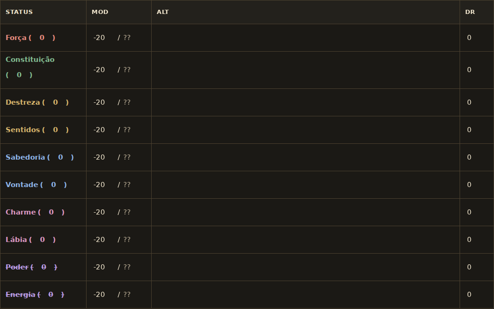

# Status da ficha

A seção de status segue a tabela da referência: **STATUS**, **MOD**, **ALT** e **DR**. Os dez atributos mantêm a ordem e as cores; o valor fica entre parênteses junto ao nome. MOD e limite compartilham a segunda coluna, com `??` apenas como indicação de limite ainda não preenchido.

Os status bloqueados ficam riscados. Seus valores continuam editáveis, e os controles de desbloqueio e talentos ficam em **Detalhes e cálculos dos status**, junto aos cálculos de valor diário, limite de ganho e valor por idade. Os sete registros de cada atributo são preservados.

No celular, a rolagem fica dentro da tabela. A coluna de nomes permanece fixa a partir de 360 pixels; em telas menores, todas as colunas podem deslizar para deixar ALT inteiramente visível. O foco, os detalhes abertos e a posição horizontal são preservados ao recalcular.

## Validação

- 2.258 testes em 37 arquivos e build de produção aprovados.
- Dez linhas, quatro cabeçalhos e 70 controles únicos com rótulos acessíveis.
- Edição, recarregamento, exportação e importação mantêm os registros e os cálculos manuais.
- Os testes cobrem detalhes, foco e rolagem após alterações, dados importados seguros e a independência entre valor e MOD.
- Interface conferida em 320, 390 e 1440 pixels, nos temas claro e escuro.

A mudança usa o mesmo esquema da ficha e não altera regras ou cálculos do RPG.
