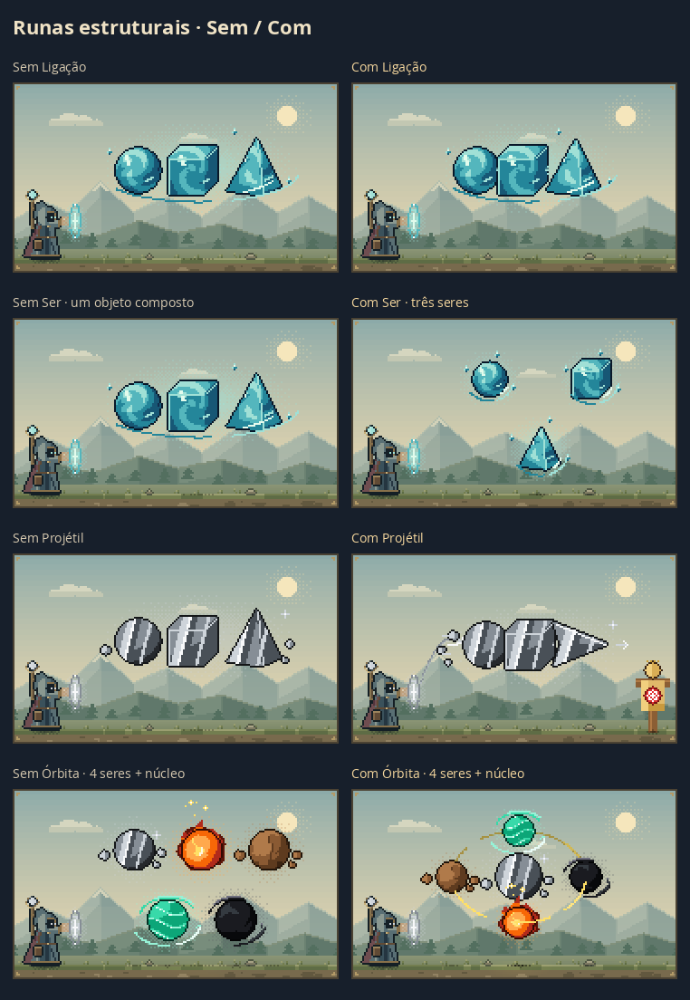

# Runas estruturais e aparência da magia

A prévia passa a respeitar a identidade física de cada runa e seus grupos, em vez de associar alvos apenas pelo nome do elemento ou formato. As regras de energia e os verificadores estruturais permanecem como fonte de verdade.

## Alcance corrigido

- Em `Fogo → Esfera → Ser → Água → Esfera → Toque`, somente o grupo de Água recebe Toque. A repetição de Esfera não transmite o efeito ao Fogo.
- Estado, Ligação e Intenção também deixam de atingir outro ser só porque ele usa uma runa de mesmo nome. A cor herdada da Matriz não faz um modificador de um grupo alcançar os demais.
- Ser separa grupos dentro de um único selo, da Matriz e de selos que atuam como fonte. As ocorrências distintas de uma runa interna são preservadas.
- Duas rotas que compartilham uma mesma forma física não duplicam o objeto na cena. Duas formas distintas com a mesma runa continuam sendo duas.
- Estado e Intenção internos da fonte mantêm sua contribuição global; Intenção de um círculo anterior não se espalha para círculos independentes.

## Manipulação visível

| Estrutura | Representação |
|---|---|
| Ser | Conjuntos separados, com suas próprias posições e alvos |
| Ligação | Peças encostadas e junções visíveis; mesma família ganha sobreposição e paleta contínua |
| Projétil | Corpo montado com eixo horizontal e pontas na frente, independente do destino |
| Estado | Cantos dourados e suporte curto de estabilidade |
| Órbita | Seres igualmente espaçados; arcos com direção e profundidade |
| D.N. | Guias no eixo protegido, sem transformar a regra em uma barreira física |
| Toque / Área | Contato local próximo / contorno de projeção na superfície distante |
| Direção Contrária | Caminho de retorno e manifestação junto do corpo do personagem |
| Intenção | Palavra ligada ao grupo correto; texto completo acessível |
| Conceitos puros | Auras transparentes e marcas de contato, sem objeto sólido inventado |

## Verificações

- 547 testes e build aprovados. Revisão independente do escopo: 167 testes focados e 14 modelos adicionais, sem bloqueios restantes.
- 52 cenas controladas em dia/noite: 48 de estruturas e 4 de materiais. Pares sem/com estrutura e testes de distribuição com 8 orbitais, 6 contatos, 5 seres em voo e projétil de 8 formatos. Nenhum ser ou formato é descartado pelo ajuste de escala.
- Órbita manipulada pela interface real: inicial, retirar, recolocar, desfazer e refazer produzem contagens `1 → 0 → 1 → 0 → 1` e restauram exatamente as imagens correspondentes.
- Comparação dos 45 exemplos com `80ca51e`: 36 aparências idênticas. Seis correções apenas fecham grupos da fonte por Ser; `ex4` perde a cópia indevida do mesmo Cubo; `falha_m_passo` deixa de mostrar Toque sem alvo anterior; `m_passo_ilusorio` separa Movimento aberto de Ilusão fechada. São interpretações alinhadas aos verificadores e descrições existentes.
- Energia, Conjuração, Poder e efeitos dos 45 exemplos permanecem iguais. Alcance, Área e narrativa acompanham as correções de agrupamento e alvo.
- SVG e PNG dos círculos comparados nos dois temas; as cenas vazias também foram comparadas pixel a pixel.
- Capturas reais em Chromium, desktop e celulares de 390/320 px. Dados de demonstração.
