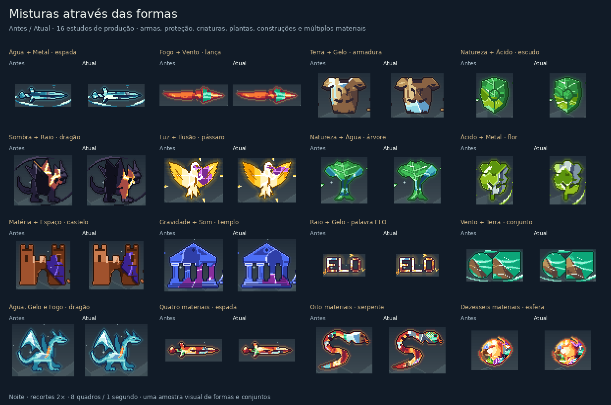

# Misturas de materiais em todo o catálogo

Esta revisão continua `19317dba241cad7d13226b519346a86b2a207420`. O compositor geral atende aos 16 materiais físicos nas 200 formas de Intenção, nos glifos, nos quatro formatos estruturais e nos corpos compostos. Cópias, lançamento, retorno e órbitas usam o mesmo sistema com detalhes adaptados ao tamanho disponível.

As dez duplas de esferas com desenho próprio conservam sua construção. O dragão liderado por Água com Gelo, inclusive com Fogo, mantém as placas desenhadas para sua asa e seu ombro; uma refração breve percorre essas bordas. Os demais pares e misturas de três ou mais materiais recebem a composição geral, inclusive os pares antes presos a uma pintura antiga nas intenções.

## Construção visual

| Materiais | Superfície e movimento |
| --- | --- |
| Fogo, Raio, Luz | Dobras quentes conectadas, descargas angulares e planos de radiância; cada um tem uma frente própria. |
| Terra, Metal, Gelo, Matéria | Blocos minerais, reflexos estreitos, facetas de cristal e juntas construídas; as formas rígidas permanecem fixas. |
| Água, Ácido | Correntes curvas, cristas, canais e meniscos; o movimento permanece dentro do material. |
| Vento, Som | Linhas abertas de fluxo e frentes curvas de pressão. |
| Natureza | Nervuras enraizadas e ramificações com um pulso que acompanha sua estrutura. |
| Ilusão, Sombra, Gravidade, Espaço | Planos deslocados, recessos, trajetórias comprimidas e dobras internas. |

As regiões usam uma métrica geométrica compartilhada: fluxo, facetas, dobras, raízes ou arcos de pulso. A escolha depende dos materiais presentes e fica estável durante a animação. O crescimento acompanha pixels ocupados e respeita os vazios reais do desenho. Lâminas, anéis e traços estreitos usam coordenadas ao longo da própria forma.

Nas intenções, palavras e anatomias, uma máscara da paleta original reserva somente áreas pintáveis da pose de referência. Olhos, cortes e brilhos protegidos não consomem a cota de um elemento. Se duas âncoras acabam em células pequenas demais, o sistema tenta novamente um espalhamento determinístico antes de reduzir o orçamento. A máscara também participa da chave do cache; brilhos do quadro atual não redistribuem os materiais.

A iluminação conserva o relevo amplo da peça original. No compositor geral, olhos, cortes escuros, realces e transparências continuam protegidos. O dragão autoral de Água com Gelo conserva a exceção existente: as placas podem cobrir brilhos não semânticos da água. Reflexos de outra cor ficam no contato entre materiais, em poucos níveis de intensidade; não existe uma média global das paletas. O retorno espelha também a ordem dos contatos, evitando pequenos saltos de cor.

As oito runas de conceito permanecem auras e não viram regiões de material. A resposta visual de fusão exige a lista exata de materiais em `materialFusion`; `linked` e `merged` isolados não autorizam inferir uma fusão.

## Exemplos



[Formas animadas](visuals/universal-mixtures/gallery-night.gif) · [Cópias, órbitas e retorno](visuals/universal-mixtures/contexts-night.gif) · [Matriz dos 240 pares](visuals/universal-mixtures/matrix-current-night.png) · [Matriz anterior](visuals/universal-mixtures/matrix-before-night.png)

O [manifesto visual](visuals/universal-mixtures/manifest.json) compara o renderer anterior congelado, SHA256 `0f4dbff995c62b8718c814e88aa55ca41f43a5877f95ad84e74afd09d346f674`, com as fontes reais desta revisão. Os PNGs conservam as cores exatas; os GIFs mostram os oito quadros em um ciclo de um segundo. Há versões durante o dia e à noite.

A prova gerou **8.960 capturas** e passou em **752 comparações exatas** de arte preservada, além de 9.856 verificações de limites e 9.312 de ciclo, borda e entrada. Os 220 pares genéricos mudaram; os 16 elementos puros, as 20 dominâncias autorais e os controles adicionais mantiveram os pixels anteriores. A galeria e os contextos são amostras visuais das formas, sem pretender mostrar o catálogo inteiro.

## Validação e limites

A suíte final passou com **3.172 testes em 89 arquivos**, incluindo regressões para os materiais ocultos no nunchaku em miniatura, na palavra VÉU e em composições de dezesseis materiais. TypeScript, build de produção e auditoria de todas as dependências passaram; a auditoria não encontrou vulnerabilidades.

O [relatório do catálogo](visuals/universal-mixtures/catalog-validation.json) registra a matriz executada, hashes, verificações e os materiais que ficaram sem pixels após a proteção do desenho. A matriz cruza os 240 pares ordenados com as 200 intenções: 48.000 cenas. Eixos adicionais verificam formas estruturais, os 560 trios sem repetição numa forma representativa, palavras, conceitos, animações, cópias e órbitas. Misturas com quatro, oito e dezesseis materiais são amostradas em diferentes formas e ordens.

Foram concluídas **61.192 fixtures**, **69.616 renderizações de produção**, **56.832 probes transparentes** e **8.424 verificações de ciclo**, sem falhas de alfa, cortes, limites, borda ou mutação. Os 48.000 pares com intenções no tamanho normal, os 560 trios, as 768 composições com quatro a dezesseis materiais e as 1.440 palavras apresentaram todos os materiais nos probes. Os 38 casos da primeira varredura foram recuperados.

O relatório final registra 40 probes com um material ausente, todos em cópias de tamanho 4: cinco fixtures repetidas nos oito quadros. São Chicote Fogo/Sombra, Corrente Fogo/Matéria, Flauta Sombra/Metal, Chicote Gravidade/Terra e Corrente Gravidade/Água. Têm 4, 5 ou 12 pixels úteis divididos entre dois a quatro componentes; a distribuição mantém a primazia do primeiro material e o orçamento mínimo de cada região. Essa política limita as duas cores nessa escala; não é uma prova de impossibilidade de outra composição visual. Os mesmos casos no tamanho normal mantêm os materiais.

As cenas usam o renderer real sem substituições de código. Probes separados em uma superfície transparente verificam alfa, cortes, realces e presença de cor nos desenhos de Intenção; eles não são apresentados como uma captura interna do corpo exato do renderer. O eixo de fusão fornece metadados sintéticos ao renderer e não substitui os testes do interpretador de círculos.

Presença de cor não garante uma assinatura legível. Uma cópia de poucos pixels pode não comportar todos os materiais; a rotina preserva o desenho e informa os materiais ausentes. A conectividade nominal da alocação também não garante que todos os pixels recoloridos continuem conectados depois da proteção de olhos e cortes. Não foram enumeradas todas as ordens e subconjuntos de três a dezesseis materiais em cada sprite.

As regiões ficam em um cache limitado. Novas posições, inclusive nas órbitas, podem exigir nova alocação; esta revisão não estabelece FPS nem desempenho em celular. A inspeção visual usa as imagens do renderer, sem uma nova sessão interativa no navegador. As runas, os círculos do editor e as regras do RPG não foram alterados.

## Reprodução

Em um checkout de `19317dba241cad7d13226b519346a86b2a207420`, depois de `npm ci`, congele a base:

```sh
node --input-type=module <<'JS'
import { build } from 'esbuild';
await build({
  stdin: {
    contents: `export {renderPixelScene,PW,PH} from './src/ui/pixel-scene';
      export {appearanceForScene,layoutScene,boundsOfBeing} from './src/ui/pixel-scene-layout';
      export {pairSpriteOf} from './src/ui/pixel-pair-sprites';
      export {spellSpriteOf} from './src/ui/pixel-spell-sprites';
      export {paintAllocatedMixture} from './src/ui/pixel-mixture-compositor';
      export {paintMaterialInteraction,usesAllocatedMixture} from './src/ui/pixel-material-interaction';
      export {Pix} from './src/ui/pixel';`,
    resolveDir: process.cwd(), loader: 'ts'
  },
  bundle: true, platform: 'node', format: 'esm', outfile: '/tmp/universal-baseline.mjs'
});
JS
```

Na revisão das misturas universais:

```sh
npm ci
npm test -- --maxWorkers=2
npm run build
npm audit --omit=dev --audit-level=high
node scripts/proof-universal-mixtures.mjs --baseline /tmp/universal-baseline.mjs
node scripts/check-universal-mixtures.mjs --output /tmp/universal-catalog.json
```

A prova visual requer Python com Pillow e remove as capturas temporárias ao terminar. A matriz também aceita `--shard 0/4` até `--shard 3/4`. Só reúna relatórios com os mesmos hashes e plano, sem falhas, com todos os índices e `shardComplete: true`.
