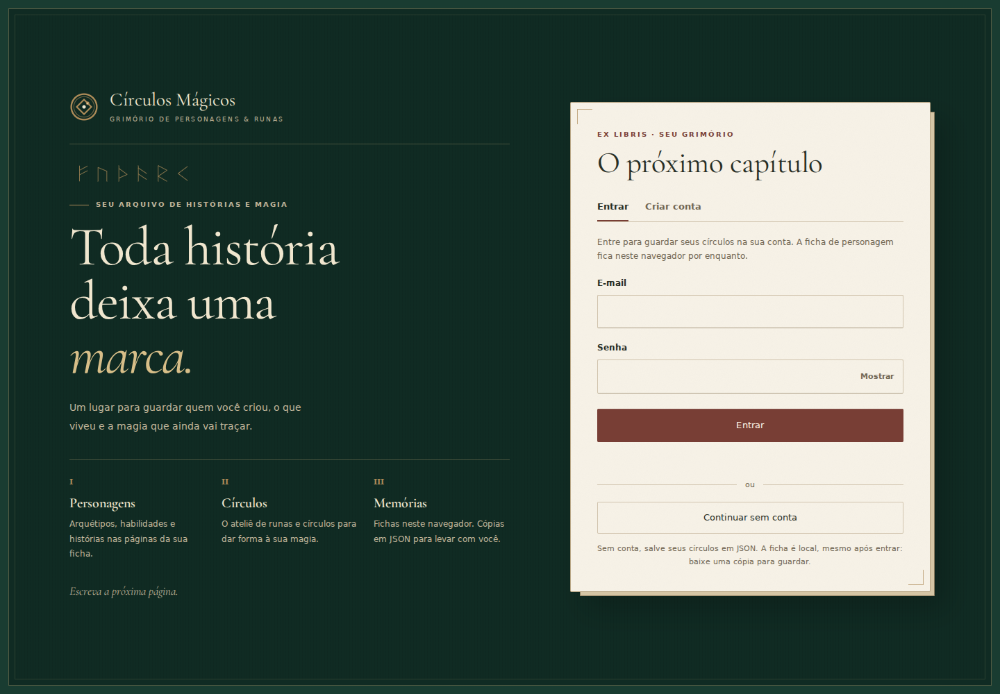
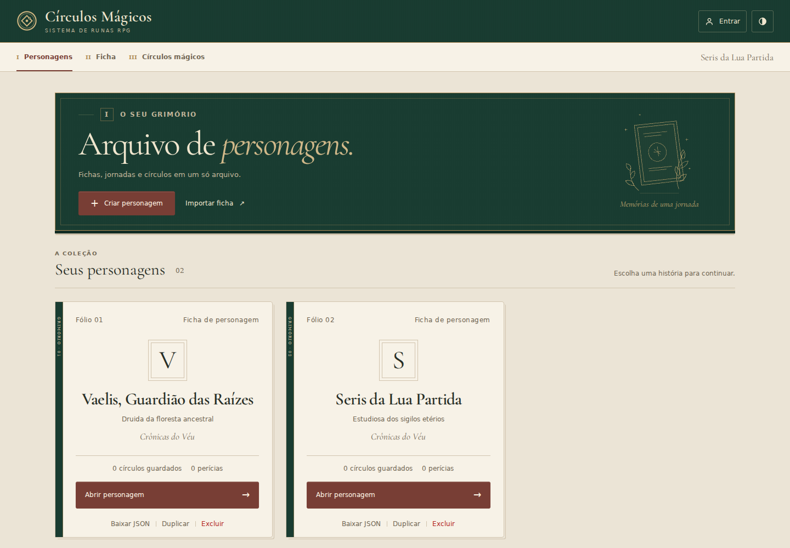
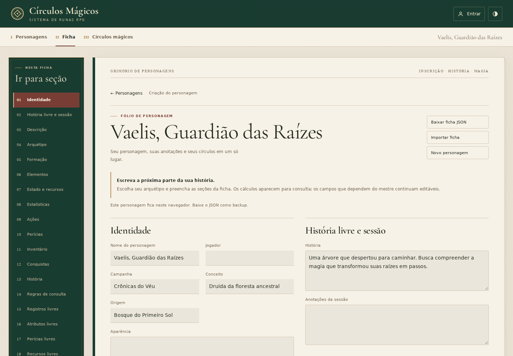
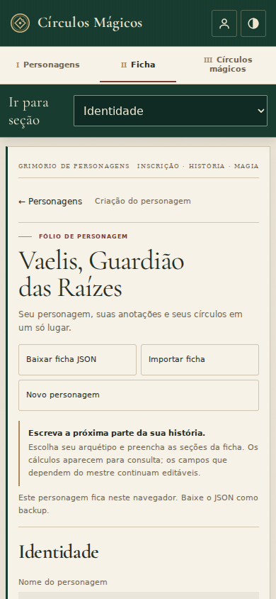

# Grimório encadernado — revisão visual

A entrada usa uma capa verde e uma placa de acesso em papel. A coleção organiza personagens em volumes com lombada, monograma e ações de leitura. A ficha passa a ser uma página contínua, com campos de registro e índice de capítulos. Títulos usam Cormorant Garamond local; campos mantêm fonte sem serifa.

## Capturas da implementação

Dados fictícios, criados pela interface em uma sessão local de verificação.

### Entrada · 1440 × 1000

### Personagens · 1440 × 1000

### Ficha · 1440 × 1000

### Ficha · 390 × 844

## Verificações

- `npm test`: 382 testes em 19 arquivos.
- `npm run build`: TypeScript e build de produção concluídos.
- Chromium: 14 estados de entrada, coleção vazia/preenchida, ficha e editor, incluindo os temas claro e escuro e larguras de 1440, 390 e 320 px. Nenhum erro de JavaScript ou transbordamento horizontal observado nessas capturas.
- Fontes locais: três arquivos usados na navegação receberam HTTP 200. Os seis arquivos distribuídos incluem os subconjuntos Latin/Latin Extended, pesos 400/600 e itálico 400.
- Texto secundário: contraste de 5,05:1 sobre papel claro, 6,89:1 sobre papel escuro e 6,03:1 sobre a capa. A ação primária tem contraste de 7,71:1.
- Menu Exportar nos dois temas: texto em hover a 7,60:1 e descrição a 4,70:1; opções dos exemplos a 12,15:1.
- A navegação mantém o índice fixo, o seletor móvel e o foco nos títulos. Voltar à coleção/ficha restaura o início da página sem recortar a apresentação.

## Preservação dos círculos

A comparação usa a versão anterior (`d676f6b`) e a nova interface, com o mesmo desenho inicial e as mesmas opções de exportação. Os nove tokens legados consultados no `body` são iguais nos dois temas. Tanto o SVG exportado quanto sua imagem renderizada a 800 × 800 px são idênticos byte a byte nos temas claro e escuro. A nova paleta é restrita à interface e não altera os tokens de renderização/exportação do editor.

Esta verificação é uma amostra visual em Chromium; os testes existentes cobrem regras, fichas, persistência e navegação.
