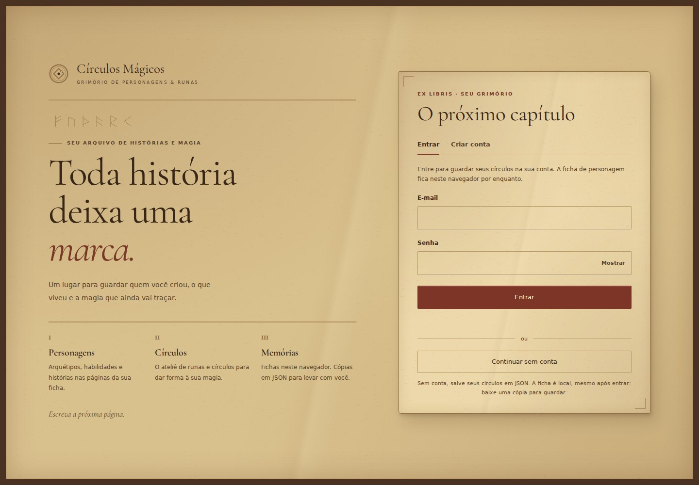
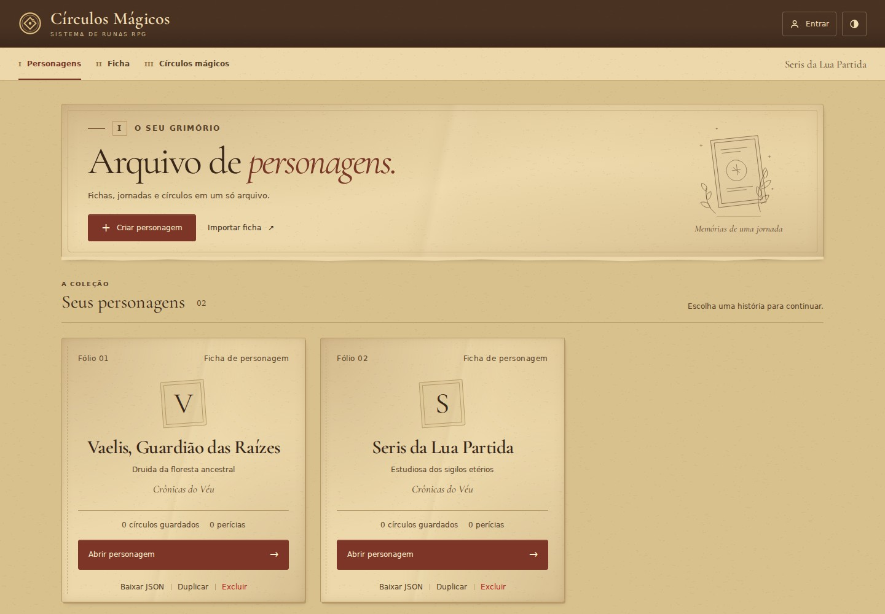
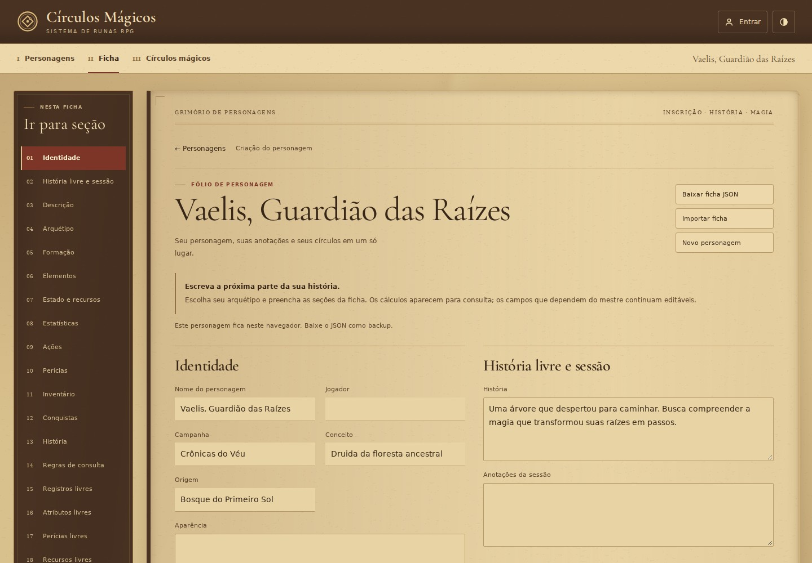
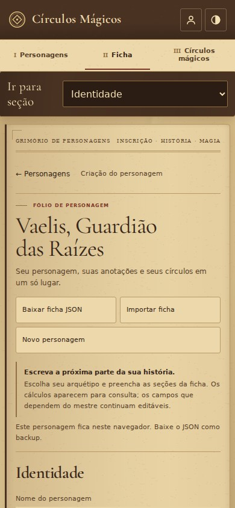

# Pergaminho rústico — revisão visual

A entrada, a coleção e a ficha usam papel envelhecido em tons de sépia. Fibras, manchas suaves, margens escurecidas, uma dobra discreta e bordas irregulares dão ao manuscrito um acabamento rústico. Os personagens aparecem como folhas costuradas, com iniciais carimbadas; o índice usa marrom escuro. Títulos usam Cormorant Garamond local; campos mantêm fonte sem serifa e fundo uniforme.

A textura é um pequeno SVG com geometria estática e gradientes CSS, sem filtros, scripts ou recursos externos. As bordas recortam somente elementos decorativos; controles, foco e navegação continuam livres. Os temas escuro e Caderno têm paletas próprias.

## Capturas da implementação

Dados fictícios, criados pela interface em uma sessão local de verificação.

### Entrada · 1440 × 1000

### Personagens · 1440 × 1000

### Ficha · 1440 × 1000

### Ficha · 390 × 844

## Verificações

- `npm test`: 382 testes em 19 arquivos.
- `npm run build`: TypeScript e build de produção concluídos.
- Chromium: 16 estados de entrada, coleção vazia/preenchida, ficha, editor e menu Exportar, incluindo os temas claro e escuro e larguras de 1440, 390 e 320 px. Nenhum erro de JavaScript ou transbordamento horizontal observado nessas capturas.
- Fontes locais: três arquivos usados na navegação receberam HTTP 200. Os seis arquivos distribuídos incluem os subconjuntos Latin/Latin Extended, pesos 400/600 e itálico 400.
- Texto secundário escurecido no tema claro para preservar a leitura nas áreas manchadas. Amostras do fundo junto ao texto deram contraste mínimo de 4,57:1 na apresentação de acesso e 4,73:1 nas legendas da ficha. As texturas ficam atrás do conteúdo, sem aplicar opacidade aos textos.
- Menu Exportar nos dois temas: texto em hover a 7,08:1 e descrição a 4,87:1; opções dos exemplos a 12,52:1.
- A navegação mantém o índice fixo, o seletor móvel e o foco nos títulos. Voltar à coleção/ficha restaura o início da página sem recortar a apresentação.

## Preservação dos círculos

A comparação usa a versão anterior (`d676f6b`) e a nova interface, com o mesmo desenho inicial, as mesmas opções de exportação e o mesmo renderizador de software no Chromium. Os nove tokens legados consultados no `body` são iguais nos dois temas. Tanto o SVG exportado quanto sua imagem renderizada a 800 × 800 px são idênticos byte a byte nos temas claro e escuro. A nova paleta é restrita à interface e não altera os tokens de renderização/exportação do editor.

Esta verificação é uma amostra visual em Chromium; os testes existentes cobrem regras, fichas, persistência e navegação.
