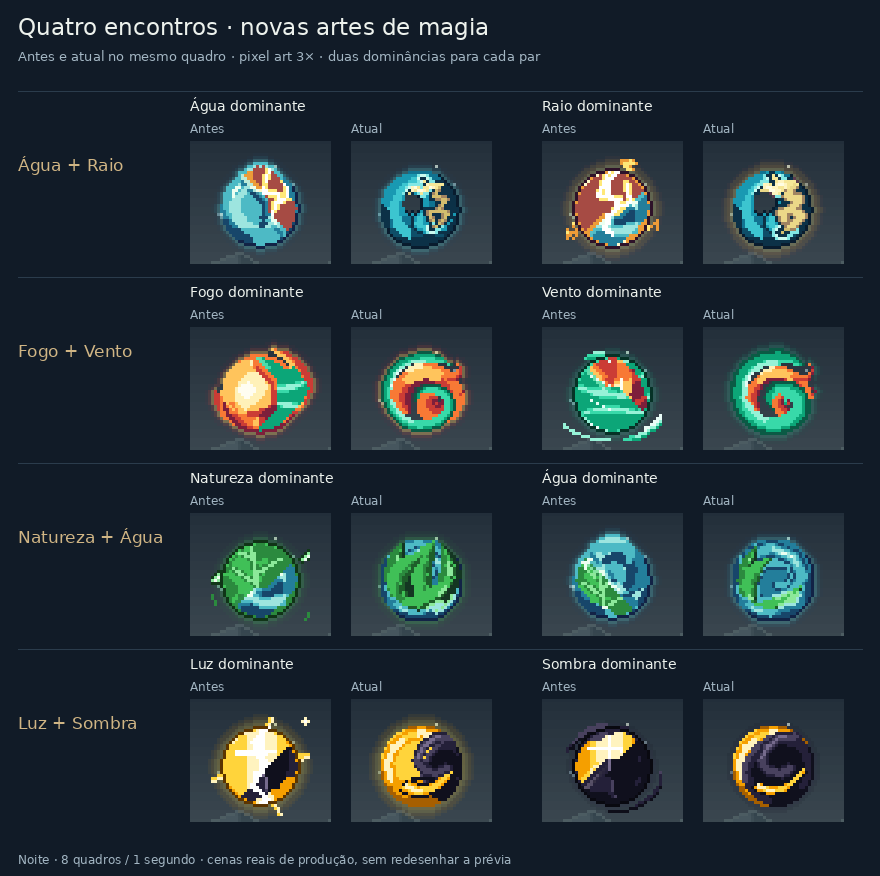

# Quatro novas composições de elementos

Esta revisão parte de `71c881c24fa322dcea37271aa1b0b66f6123001c`, a etapa dos contatos animados. Quatro pares recebem agora uma construção própria, com sobreposições e canais internos desenhados para o encontro dos materiais.

| Par | Construção e movimento |
| --- | --- |
| Água + Raio | Uma corrente turquesa volumosa retorna para o centro e deixa um olho pequeno e deslocado. A descarga dourada percorre um canal angular aberto; a caústica da água responde um quadro depois. |
| Fogo + Vento | O vento jade se enrola e passa pela frente de uma chama com ombro laranja e base vermelha. Duas línguas acompanham a corrente com atraso, mantendo canais vazados entre as voltas. |
| Natureza + Água | Folhas dobradas abraçam a corrente. Nervuras partem das raízes submersas, e o menisco cruza o pé das folhas antes de reaparecer à frente. |
| Luz + Sombra | Um volume dourado entra sob uma dobra violeta e reaparece numa abertura afunilada. A dobra abre e fecha localmente, conservando o vazio escuro e a iluminação do ombro. |

Cada par tem duas dominâncias com proporções próprias. A seleção exige exatamente dois elementos e uma esfera, sem forma ou palavra de Intenção. Cópias, órbitas e retorno usam a mesma construção e os limites do ciclo completo. Intenções, glifos, formas compostas e misturas de três ou mais elementos continuam nas suas rotas existentes.

O recorte de corpos espelhados foi corrigido: uma superfície que fica fora da tela antes do espelhamento ainda pode aparecer dentro da tela depois dele. A pintura usa coordenadas virtuais nesse caso e recorta no destino final. Os testes comparam o resultado com um recorte do corpo completo nos quatro cantos.

## Comparações



[Antes e depois animados](visuals/woven-junctions/comparison-night.gif) · [Durante o dia](visuals/woven-junctions/comparison-day.gif) · [Cópias, órbitas e retorno](visuals/woven-junctions/contexts-night.gif)

A comparação usa o renderer anterior congelado, SHA256 `a51f941a3f3a46dd7961940cf632325fdd6caa047b49d9cdf76d0b55897c1cf5`, e compila as fontes reais da revisão. O recorte compartilhado deriva dos limites de ambas as versões nos oito quadros. Os PNGs mantêm as cores exatas; os GIFs usam uma paleta global, oito quadros e ciclo de um segundo.

O [manifesto](visuals/woven-junctions/manifest.json) registra as fontes, os resultados e os controles. A prova inclui as oito dominâncias novas, lançamento, retorno, seis manifestações, oito órbitas e conceitos. Os controles comparam os seis pares da etapa anterior, os elementos puros, o lança-chamas e contextos fora desta revisão.

Foram geradas 640 capturas e feitas 704 comparações exatas de arte preservada: 608 em 38 controles e 96 nos seis contextos excluídos. Passaram 2.400 verificações de limites e 1.856 verificações de ciclo, de borda e de preservação dos dados de entrada.

Os testes verificam a presença dos dois materiais nas escalas pequenas, mudanças de proporção com a dominância, movimento ao longo dos contatos e ciclos exatos. A integração também compara os pixels dos novos corpos com as cenas reais durante o dia e à noite.

A suíte completa passou com 3.045 testes em 83 arquivos. TypeScript, build de produção e auditoria sem vulnerabilidades também passaram. A integração inclui 1.280 poses conectadas, 192 recortes exatos nos quatro cantos e 128 comparações do corpo com a cena real.

A construção de Fogo/Vento usa caixas por segmento e distâncias quadradas para reduzir o custo de calcular as curvas. A otimização preservou 1.536 rasters idênticos byte a byte à nova arte antes da otimização.

## Reprodução

Em um checkout de `71c881c24fa322dcea37271aa1b0b66f6123001c`, após `npm ci`, congele a base:

```sh
node --input-type=module <<'JS'
import { build } from 'esbuild';
await build({
  stdin: {
    contents: `export {renderPixelScene,PW,PH} from './src/ui/pixel-scene';
      export {appearanceForScene,layoutScene,boundsOfBeing} from './src/ui/pixel-scene-layout';
      export {spellSpriteOf,paintSpellSprite,spellSpriteBounds} from './src/ui/pixel-spell-sprites';
      export {pairSpriteOf} from './src/ui/pixel-pair-sprites';
      export {paintAllocatedMixture} from './src/ui/pixel-mixture-compositor';
      export {Pix} from './src/ui/pixel';`,
    resolveDir: process.cwd(), loader: 'ts'
  },
  bundle: true, platform: 'node', format: 'esm', outfile: '/tmp/woven-baseline.mjs'
});
JS
```

Na revisão atual:

```sh
npm ci
npm run typecheck
npm test -- --maxWorkers=2
npm run build
npm audit --audit-level=low
node scripts/proof-woven-junctions.mjs --baseline /tmp/woven-baseline.mjs
```

O compositor requer Python com Pillow e remove as capturas temporárias ao terminar. A validação visual usa a saída do renderer; não inclui uma nova sessão interativa no navegador ou medição em celular. As runas, os círculos do editor e as regras do RPG não foram alterados nesta etapa.
